# 🏛️ GovBiz

**Ai Agent 정부지원 사업 탐색·신청 관리 플랫폼**

<a id="팀-소개"></a>

## 1. 팀 소개

<!-- 팀원 소개는 보존된 3차 프로젝트 README의 이름·GitHub 프로필을 참고했습니다. -->

<table>
  <tr>
    <td align="center">
      <br>
      <b>김건우(PM)</b><br>
      <a href="https://github.com/ilil1">
        
      </a>
    </td>
    <td align="center">
      <br>
      <b>김동섭</b><br>
      <a href="https://github.com/20220348-kim">
        
      </a>
    </td>
    <td align="center">
      <br>
      <b>이성민</b><br>
      <a href="https://github.com/lsm15111">
        
      </a>
    </td>
  </tr>
</table>

<a id="프로젝트-개요"></a>

## 2. 프로젝트 개요

### 2.1 어떤 서비스인가요?

GovBiz는 여러 기관에 흩어진 정부지원사업 공고를 모아 기업의 조건과 목적에 맞게 탐색하도록 돕는 서비스입니다.
사용자는 AI 대화 또는 직접 필터로 공고를 찾고, 추천 이유와 지원 조건을 원문에서 확인합니다.
관심 공고 저장, 신청 문서 작성, 진행 단계 관리, 중복 지원 검토와 협업 제안으로 이어갈 수 있습니다.

### 2.2 해결하려는 문제

| 사용자가 겪는 문제 | GovBiz의 해결 방법 |
|---|---|
| 기관마다 공고가 흩어져 있어 찾고 비교하기 어려움 | 공식 제공처 4곳의 공고를 수집·정규화하고 통합 검색 |
| 키워드만으로 우리 기업에 맞는 사업을 고르기 어려움 | AI 대화로 조건을 구체화하고 키워드·의미 검색을 결합 |
| AI 답변의 근거와 신청 조건을 확인하기 어려움 | 공식 본문의 인용 근거, 추천 이유와 자격 확인 정보를 함께 표시 |
| 공고 탐색 이후 문서·일정·협업을 따로 관리해야 함 | 관심함·달력·신청 문서·진행 관리·협업 기능을 연결 |
| 모델이나 프롬프트 변경의 영향을 확인하기 어려움 | 같은 평가 자료로 결과를 비교하고 검토·사용량·실패 이력을 보존 |

<a id="주요-기능"></a>

## 3. 주요 기능과 사용 흐름

### 3.1 사용자는 이렇게 이용합니다

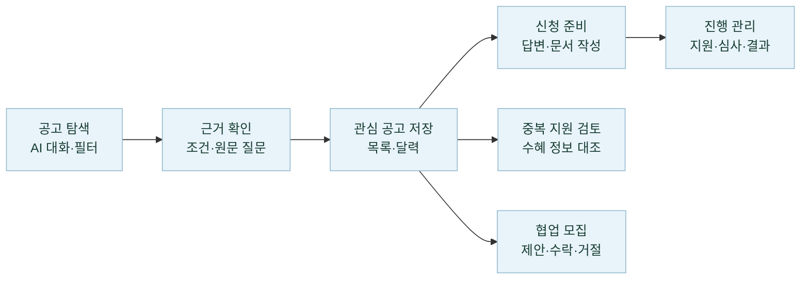

### 3.2 관리자는 이렇게 운영합니다


### 3.3 기능별 상세 설명

| 기능 | 현재 구현 |
|---|---|
| **공고 검색·추천** | AI 대화로 조건을 제안하고 사용자 확인 후 검색합니다. 직접 필터 검색은 키워드·지역·분야·출처·접수 상태와 K-Startup 추가 조건, 정렬·페이지 이동을 제공합니다. AI 추천은 키워드·의미 검색 후보를 결합해 관련도와 자격 근거를 표시합니다. |
| **공고 상세·원문 질문** | 접수 기간·신청 방법·공식 문의처·지원 조건을 조회하고 공식 원문으로 이동합니다. 기업마당·K-Startup 상세 HTML에 질문하면 답변과 인용 근거를 확인할 수 있습니다. |
| **관심 공고·진행 관리** | 공고 저장·해제, 목록·달력·진행 관리 보기와 신청 문서의 준비·지원·심사·결과 단계를 관리합니다. |
| **신청 문서 작성** | 공식 양식·문항 발견, 문항별 답변 저장·검토, AI 초안과 생성 작업 조회, 지원 형식의 원본 문서 작성·다운로드를 제공합니다. 모바일은 파일 저장·공유로 연결합니다. [형식별 지원 범위](docs/application-document-mcp-architecture.md) |
| **중복 지원·수혜 검토** | 선택한 공고·기존 수혜 정보를 공식 근거와 대조하고 사업쌍별 판단·인용·기관 확인 사항을 저장합니다. 비동기 분석 상태와 결과를 다시 조회할 수 있습니다. |
| **협업·파트너** | 모집글 목록·상세·작성·수정, 내 모집글, 받은·보낸 제안과 수락·거절·철회를 제공합니다. 기업 등록·사업자 상태에 따른 이용 조건을 적용합니다. |
| **계정·기업 정보** | 이메일 인증 가입·로그인, 비밀번호 재설정, 설정된 소셜 로그인, 사업자 조회·기업 등록·수정, 회원별 대화 보관·복원을 제공합니다. |
| **맞춤 리포트·알림** | 기업 조건에 맞춘 리포트 생성·조회, 수신 설정과 이메일·앱 푸시, 관심 공고 마감 N일 전 알림을 구현했습니다. 발송 설정과 수신 동의·기기 등록이 필요합니다. [리포트](docs/daily-reports.md) · [마감 알림](docs/deadline-reminders.md) |
| **GovBiz 도우미** | 이용 방법 안내, 기업 정보·협업 모집 조회, 관심 공고 묶음 질문을 처리합니다. LangGraph 도우미가 권한 범위의 읽기 전용 도구를 호출합니다. |
| **관리자·LLMOps** | 회원 조회·정지·강제 로그아웃·권한 변경·감사 기록, 작업 큐 현황과 별도 LLMOps 평가·검토·비교 기준·예산 관리를 제공합니다. |

<a id="기술-스택"></a>

## 4. 기술 스택

| 영역 | 적용 기술 |
|---|---|
| 구현 언어 | Kotlin, Python 3.12, TypeScript 6 |
| 웹 프론트엔드 | React 19, Vite 8, Tailwind CSS 4, React Router, Redux Toolkit, Zod |
| 모바일 | React Native, Expo, Expo Router, Firebase App Distribution(테스트 앱 배포) |
| 업무·수집 API | Spring Boot, JDK 21, MyBatis, Flyway |
| AI API·Agent | FastAPI, OpenAI, LangChain, LangGraph, OpenAI Agents SDK |
| 평가 운영 API | Django, Django REST Framework |
| 데이터 저장·검색 | MySQL 8.4, Elasticsearch(Nori/BM25), Qdrant |
| 캐시·비동기 처리 | Redis, RabbitMQ |
| LLMOps | Langfuse, Prefect, Pandera, Evidently, pandas |
| 로컬 실행·컨테이너 | Docker Compose, Kubernetes(kind), Helm |
| AWS 인프라 | Amazon EKS, Amazon EC2(워커 노드), Amazon EBS(gp3), Amazon VPC |
| API 진입·프록시 | Amazon CloudFront, Application Load Balancer(ALB), Nginx |
| 웹 배포 | Vercel |
| 검증·이미지 관리 | GitHub Actions, GitHub Container Registry(GHCR), Amazon ECR |
| AWS 배포 도구 | AWS CloudFormation, eksctl, AWS CodeConnections, AWS CodeBuild |
| GitOps 배포 | Helm, Argo CD |
| 모노레포·공통 계약 | pnpm workspace, 웹·앱 공통 TypeScript 계약 |

버전 기준은 [루트 설정](package.json), [웹](frontend/web/package.json), [모바일](frontend/mobile/package.json),
[AI](backend/ai-service/pyproject.toml), [Ops](backend/ops-service/pyproject.toml)과 각 잠금 파일입니다.
서비스별 역할은 아래 [시스템 아키텍처](#서비스-구성)에 정리했습니다.
AWS 배포 구성과 검증 범위는 [EKS 배포](infrastructure/eks/README.md),
[API 연결 경로](infrastructure/eks/api-entrypoint.md), [자동 배포 연결·검증 상태](infrastructure/eks/continuous-deployment.md)를 참고하세요.

<a id="서비스-구성"></a>

## 5. 시스템 아키텍처

GovBiz는 **사용자 업무·공고 수집·AI 처리·평가 운영**을 독립 서비스로 나누고,
HTTP API와 비동기 메시지로 연결합니다.

<a id="서비스-연결"></a>

### 5.1 서비스 연결


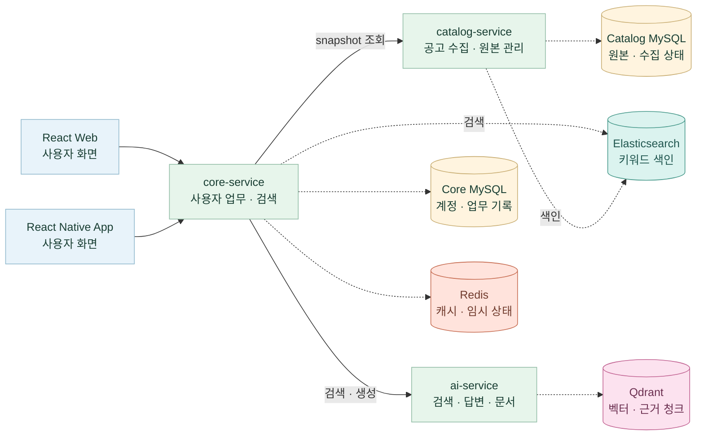


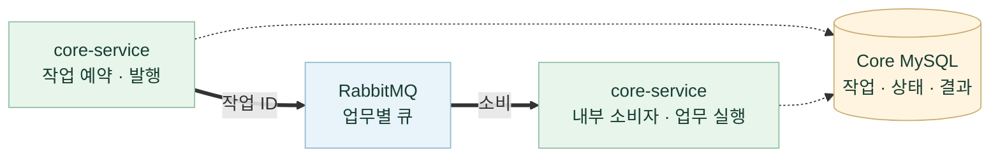

적용 업무는 **리포트 생성·메일 발송, 중복 지원 검토, 신청 양식·문항 분석, 카카오 연결 해제,
관심 공고 원문 수집·색인**입니다. 소비자는 업무에 따라 `ai-service`·공식 원문·메일 서버·카카오 API를 호출합니다.


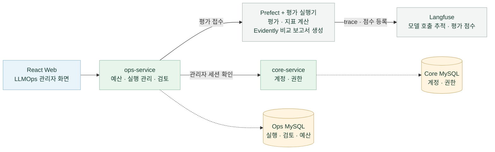

가는 실선은 서비스 호출, 굵은 실선은 큐 메시지 전달, 점선은 DB·검색 저장소·캐시 접근을 나타냅니다.
저장소는 MySQL(노랑), Qdrant(분홍), Elasticsearch(청록), Redis(주황)으로 구분합니다.
Core·Catalog·Ops의 MySQL은 같은 색을 사용하고, 서비스별 소유권은 이름으로 표시합니다.
대표적인 연결만 표시하고 응답은 생략했습니다.
웹·앱은 [Shared 패키지](docs/mobile-monorepo.md)의 업무 모델·API 계약·응답 검증을 공유합니다.

<a id="로컬-시작"></a>

### 5.2 전체 구성도

로컬은 **Docker Compose** 또는 **Kubernetes(kind)**에서 개발·검증하고, 운영은 **Vercel·AWS EKS**에서 서비스를 제공합니다.
각 구성의 실행 경계·데이터 저장·화면 접근 방식을 아래에 구분했습니다.

두 방식의 복구·확장·배치·무중단 배포 차이와 현재 선택 이유는 [Compose와 Kubernetes 비교 README](docs/README-kubernetes-vs-compose.md)에 정리했습니다.

<a id="521-docker-compose-로컬-전체-구성도"></a>


[이미지 크게 보기](docs/assets/architecture/govbiz-compose-architecture.png?v=127a77d72a67) · [SVG 원본](docs/assets/architecture/govbiz-compose-architecture.svg?v=8b508bff3504)

| 구분 | Docker Compose 구성 |
|---|---|
| **웹·모바일 접근** | 호스트 Vite(`5173`)가 Core(`8080`)·LLMOps Ops(`18001`)의 공개 포트로 프록시합니다. React Native·Expo 앱은 기기에서 접근 가능한 Core API와 Bearer 인증을 사용합니다. |
| **서비스·데이터** | 업무·LLMOps를 별도 Compose 프로젝트로 실행합니다. 프로젝트 안에서는 서비스 이름으로 통신하고, DB·검색·큐·평가 결과는 named volume에 보존합니다. |
| **평가·관측** | Prefect·평가 실행기·독립 `ops-sync`가 실행과 결과를 관리합니다. 기본 결과 조회는 공유 볼륨을 사용하며 `ops-artifacts` HTTP 방식은 선택 overlay입니다. Prefect(`14200`)·Langfuse(`13000`)는 로컬 공개 포트로 접근합니다. |
| **개발 반영** | 필요한 이미지를 빌드하고 Compose로 컨테이너를 갱신합니다. 웹은 Vite HMR, 앱은 Expo Fast Refresh를 사용합니다. 프로젝트 사이의 Core 인증·Langfuse 추적은 호스트 연결 주소를 설정합니다. |
| **기본 통합 실행과의 구분** | 루트 `compose.yaml`은 웹·업무·Ops(`8001`)의 기본 통합 경로입니다. 그림의 LLMOps 전용 Ops(`18001`)는 별도 DB·결과 볼륨을 사용하므로 같은 실행 이력으로 취급하지 않습니다. |

[Compose 구성·실행 경로 상세](docs/assets/architecture/README-compose.md) · [루트 통합 개발 안내](docs/ops-monorepo-migration.md) · [LLMOps Compose 실행](infrastructure/llmops/README.md#compose-시작)

<a id="522-kubernetes-로컬-전체-구성도"></a>


[이미지 크게 보기](docs/assets/architecture/govbiz-local-architecture.png?v=c4108a043e43) · [SVG 원본](docs/assets/architecture/govbiz-local-architecture.svg?v=06115cccb76a)

| 구분 | 로컬 구성 |
|---|---|
| **웹·모바일 접근** | 개발 중에는 Vite에서 Core·Ops로 port-forward하고, 배포한 웹은 Kubernetes의 Nginx에서 내부 API로 연결합니다. React Native·Expo 앱은 기기에서 접근 가능한 Core API 주소와 Bearer 인증을 사용합니다. |
| **관리·관측** | 같은 웹에서 관리자 Ops 화면을 제공하며, Prefect·Langfuse UI는 각각 port-forward로 접근합니다. |
| **외부 API 연결** | Catalog는 기업마당·K-Startup·과기정통부·충남 수출지원 공고 API를, AI Service는 OpenAI를 호출합니다. kind 네트워크에서 개발 PC의 인터넷 연결을 거쳐 나가는 경로이며, API 키와 기능별 실행 설정이 필요합니다. |
| **자동 배포** | GitOps 최초 인계·활성화 후 소스 동기화 → 필수 CI → GHCR 이미지 발행 → Helm 배포 YAML 생성·태그 발행 → Argo CD 자동 동기화로 연결합니다. Helm은 Chart·로컬 설정값·검증된 이미지 digest로 배포 설정을 만들고, Argo CD는 이를 kind에 반영합니다. 진행 중인 평가가 있으면 교체를 보류하고 DB·PVC·Secret은 보존합니다. |
| **Argo 실행·관리 범위** | GitOps 전환 시 `argocd` Namespace에 Argo CD Core의 Pod 4개를 설치하며 같은 kind 단일 노드에서 실행합니다. 로컬 Kubernetes API로 웹·업무·평가 앱 Deployment 7개를 관리합니다. 기본 개발 모드의 `dev.py`와 같은 Deployment를 동시에 관리하지 않습니다. |

[로컬 배치·저장소·접근 방식 상세](docs/assets/architecture/README-local.md) · [자동 배포 설정·최초 전환](infrastructure/gitops/docs/local-auto-sync.md)

<a id="523-운영-전체-구성도"></a>


**GovBiz 사용자·Ops 화면은 Vercel**, 새로 설치한 **Argo CD 배포 관리 화면은 EKS의 `argocd-server` Pod**에서 제공합니다. Argo 관리자는 CloudFront의 `/argocd/`로 직접 접속하고, 기존 내부 ALB·Gateway를 거쳐 `argocd` Namespace의 Service·Pod에 연결됩니다. 그림의 ⑥이 이 관리 웹 경로입니다.


[이미지 크게 보기](docs/assets/architecture/govbiz-aws-eks-architecture.png?v=27631e4266f5) · [SVG 원본](docs/assets/architecture/govbiz-aws-eks-architecture.svg?v=bc65fcd202fd)

| 구분 | 운영 구성 |
|---|---|
| **웹·API 접근** | Vercel의 `/api` 서버 미들웨어 → CloudFront VPC origin → 내부 ALB → EKS Nginx를 거쳐 Core·Ops로 분기합니다. 모바일의 API 주소를 Vercel origin으로 설정하면 같은 중계 경로를 거쳐 Core를 호출합니다. 모바일 운영 실기기 연결 검증은 별도입니다. |
| **서비스 실행·배치** | application에는 업무 DB·Catalog·Ops, observability에는 Langfuse·Argo CD·Prefect·평가 실행기·결과 저장소를 배치합니다. Core·AI는 같은 서비스의 Pod를 서로 다른 EC2에 배치하며, 기본 EC2 2대 상태에서는 각 노드에 Core·AI가 하나씩 실행됩니다. 단일 AZ 구성입니다. |
| **로드밸런싱** | 내부 ALB가 정상 상태의 Nginx Gateway Pod로 HTTP 요청을 분산합니다. Gateway는 업무 API를 Core·Ops Service로, `/argocd/`를 Argo Service로 전달합니다. Core는 필요할 때 AI Service를 호출합니다. Core·AI의 Service는 준비된 Pod로 연결을 분산하며, Ops·Argo 웹은 각각 단일 Pod로 전달합니다. |
| **Pod 오토스케일링 — HPA** | 컨테이너 CPU 요청량 대비 평균 사용률 60%를 기준으로 Core·AI는 각각 2\~3개, Gateway는 1\~3개로 조절합니다. Catalog·Ops·DB·평가 서비스는 단일 실행을 유지합니다. 부하 감소 시에는 5분 안정화 구간을 거쳐 Pod를 줄입니다. |
| **EC2 오토스케일링 — Cluster Autoscaler** | application은 1\~2대, observability는 1대로 전체 EC2를 기본 2대·최대 3대로 설정합니다. 기존 노드의 자원·분산 조건을 만족하지 못해 Pod가 대기하면 application 노드를 추가합니다. 세 번째 Core 또는 AI Pod는 분산 규칙상 세 번째 EC2가 필요합니다. 추가 노드가 불필요해진 상태로 10분이 지나고 남은 Pod를 안전하게 옮길 수 있으면 축소합니다. |
| **외부 API 연결** | Catalog → 공고 제공처 API, AI Service → OpenAI의 요청은 사설 Pod에서 NAT Gateway → Internet Gateway를 거쳐 나갑니다. 외부 API는 VPC 밖에 있으며, 사용자 요청이 들어오는 ALB 경로와 구분합니다. |
| **데이터 보존** | MySQL·검색·큐·평가·관측 데이터는 EBS gp3 PVC에 보존합니다. S3는 암호화한 이전 백업을 보관합니다. |
| **자동 배포** | 개인 main의 같은 최신 SHA에 대한 필수 CI 통과 → CodeBuild 빌드·ECR 발행 → Helm 배포 YAML·불변 Git 태그 발행 → Argo CD의 EKS 동기화 → Vercel 웹 전환 순서입니다. |
| **배포 도구** | Helm은 Chart·EKS 설정·이미지 digest로 YAML을 만듭니다. EKS의 `argocd` Namespace에는 Core 4개와 상시 대시보드 `argocd-server` 1개, 총 Pod 5개를 observability 노드에 배치합니다. Git의 배포 설정을 읽어 Kubernetes API로 앱·배포 hook을 동기화하고 CodeBuild는 결과를 조회합니다. |
| **배포 대시보드** | [운영 HTTPS 주소](https://d1kn7p1kr532sh.cloudfront.net/argocd/)에서 관리자 IPv4 제한과 `admin` 인증으로 접속합니다. 기존 CloudFront·내부 ALB·API Gateway를 통해 Argo의 ClusterIP `8080`에 연결하며 별도 EC2·ALB·프록시 Pod는 추가하지 않습니다. `govbiz-eks`의 업무·평가 앱 Deployment 6개와 관련 배포 리소스를 조회·관리합니다. [접속 절차](infrastructure/eks/argocd-dashboard.md) |
| **관리·관측** | 관리자 Ops는 같은 React 웹에서 이용합니다. Prefect·Langfuse UI는 EKS 권한을 가진 사용자가 port-forward로 접근합니다. |

[운영 구성·적용 및 검증 기록](docs/assets/architecture/README-aws-eks.md) · [로드밸런싱·API 진입 경로](infrastructure/eks/api-entrypoint.md) · [오토스케일링 설정](infrastructure/eks/autoscaling/README.md) · [자동 배포 상세](infrastructure/eks/continuous-deployment.md) · [서비스 호출 상세](docs/architecture.md)

그림 상단의 **EC2 표는 노드별 역할과 기본 2대·최대 3대의 운영 설정**을 나타냅니다. 아래 `govbiz-msa`·`govbiz-evaluation`·`govbiz-observability`·`argocd` 상자는 **Namespace별 논리 구분**이며, 상자의 좌우 위치가 노드를 뜻하지 않습니다. 평가 서비스와 Argo CD는 각각 `govbiz-evaluation`·`argocd` Namespace를 유지하면서 `observability` 노드에서 실행합니다. 이 노드는 관측·평가·배포 관리용으로 함께 사용하며, Argo CD를 반드시 관측 노드에 설치해야 하는 것은 아닙니다.

<a id="524-kubernetes-내부-리소스-구조"></a>


로컬과 EKS의 차이는 별도로 표시합니다. 실제 배포·노드 축소 관찰 결과는 [EKS 적용 기록](docs/assets/architecture/README-aws-eks.md#실제-적용검증-기록)을 확인합니다.

**전체 Namespace와 워크로드 배치**


[크게 보기](docs/assets/architecture/govbiz-kubernetes-resources-overview.png?v=7d1c9d8f8c22) · [SVG 원본](docs/assets/architecture/govbiz-kubernetes-resources-overview.svg?v=17ca7f7f13b2)

**Namespace는 관련 프로그램과 설정을 이름으로 묶는 공간**입니다. 이 프로젝트는 업무 서비스(`govbiz-msa`), 평가 도구(`govbiz-evaluation`), 실행 기록을 수집·조회하는 관측 도구(`govbiz-observability`), 배포 관리 도구(`argocd`)를 나누어 관리합니다. 실제 프로그램이 실행되는 서버는 **Node**, 그 서버에서 컨테이너를 실행하는 단위는 **Pod**입니다. Namespace 하나가 서버 한 대를 뜻하지는 않습니다.

그림에서 한 상자에 묶인 서비스도 각각 별도 Pod로 실행됩니다. Ops는 API인 `ops-service`와 동기화 작업인 `ops-sync` 두 컨테이너를 같은 Pod에서 실행합니다. 서비스끼리 주고받는 요청은 [5.1 서비스 연결](#51-서비스-연결)에서 확인할 수 있습니다.

EKS에서는 Core·AI를 두 노드 풀에 배치할 수 있으며, 같은 서비스끼리는 서로 다른 Node를 사용합니다. Catalog·Ops는 각각 업무 DB와 같은 application 노드에 배치됩니다. 평가·관측 서비스는 observability에 배치되며, 서로 다른 Namespace를 유지합니다. Core·AI 각각 최소 2개·최대 3개와 Gateway 최소 1개·최대 3개는 HPA의 정상 운영 범위이고, 다른 업무·평가·저장소는 단일 실행입니다.

**Argo CD 자체도 Pod로 실행**합니다. EKS는 `argocd` Namespace에 속한 Core 4개와 대시보드 1개, 총 Pod 5개를 observability Node에 배치합니다. `application-controller`는 `StatefulSet → Pod`, `repo-server`·`applicationset-controller`·Redis·`argocd-server`는 각각 `Deployment → ReplicaSet → Pod`로 관리합니다. 대시보드는 CloudFront `/argocd/`의 관리자 IPv4 제한과 `admin` 인증을 거쳐 접속합니다. 기존 Gateway가 전용 origin 비밀값을 검사한 뒤 ClusterIP `8080`의 서버 인증서를 검증해 HTTPS로 연결합니다. 로컬 kind는 상시 웹 서버 없는 Core Pod 4개를 유지합니다. Argo는 Kubernetes API 권한으로 다른 Namespace의 업무·평가 앱을 배포하며, 사용자 API 요청은 Argo를 거치지 않습니다.

**Ops API와 MySQL의 상세 관계**


[크게 보기](docs/assets/architecture/govbiz-kubernetes-resources-flow.png?v=c2fef1be08f3) · [SVG 원본](docs/assets/architecture/govbiz-kubernetes-resources-flow.svg?v=4963c5f66756)

**파란 실선은 “누가 실행을 관리하는가”**, **초록 실선은 “요청이 어디로 가는가”**, **황색 점선은 “어디에 데이터를 저장하는가”**를 나타냅니다. 그림의 각 행에 반복해서 나오는 Ops·MySQL Pod는 같은 Pod를 서로 다른 관점에서 표시한 것입니다.

- **프로그램 실행 — Deployment → ReplicaSet → Pod**: Deployment에 “어떤 버전을 몇 개 실행할지”를 정합니다. Kubernetes가 만든 ReplicaSet은 Pod가 부족하면 새로 만들어 그 수를 맞춥니다. 실제 API 프로그램은 Pod 안에서 실행됩니다.
- **API 접속 — Service → Pod**: Pod가 교체되면 IP가 달라질 수 있으므로, 다른 프로그램은 일정한 접속 주소를 제공하는 Service를 사용합니다. 일반 ClusterIP Service는 이름표(라벨)가 맞고 요청을 받을 준비가 된 Pod로 요청을 보냅니다. Deployment와 ReplicaSet은 실행을 관리할 뿐, API 요청이 지나가는 경로는 아닙니다. Ops Service로 들어온 요청은 같은 Pod의 API 컨테이너가 처리합니다.
- **데이터 보관 — StatefulSet·PVC·PV**: StatefulSet은 DB처럼 이름과 저장소 연결을 유지해야 하는 Pod를 관리합니다. ReplicaSet을 거치지 않습니다. **PVC는 “이 저장 공간을 사용하겠다”는 요청**, **PV는 실제 저장 볼륨을 Kubernetes에 등록한 정보**입니다. 같은 PVC와 연결된 볼륨을 유지하면 DB Pod가 교체되어도 기존 데이터를 다시 사용할 수 있습니다. PVC까지 삭제해도 데이터가 자동 복구된다는 뜻은 아닙니다.

Ops MySQL의 Service는 **Headless** 방식입니다. 일반 Service처럼 별도 접속 IP를 두는 대신, 서비스 이름을 조회하면 MySQL Pod의 IP를 알려줍니다. Ops API는 그 주소로 DB에 직접 연결합니다.

<details>
<summary>서비스별 리소스·포트·저장소 상세 펼치기</summary>

| 관리 공간 / 프로그램 | 실행을 관리하는 구성 | 접속 방법·데이터 보관 |
|---|---|---|
| `govbiz-msa` / Core·AI | 서비스별 `HPA → Deployment → ReplicaSet → Pod` | EKS에서 각각 최소 2개·최대 3개이며 같은 서비스끼리 Node를 분리합니다. 각 ClusterIP Service가 준비된 Pod로 연결을 분산합니다. |
| `govbiz-msa` / Catalog·Ops | 서비스별 `Deployment → ReplicaSet → Pod`, 각각 1개 | ClusterIP로 호출합니다. Ops Pod 안에서는 API와 `ops-sync`가 함께 실행됩니다. 각각 `catalog-mysql`·`ops-mysql`과 같은 Node에 배치합니다. |
| `govbiz-msa` / 로컬 `web` · EKS `api-gateway` | 각각 `Deployment → ReplicaSet → Pod`, EKS Gateway는 HPA 최소 1개·최대 3개 | Nginx가 Core·Ops의 Service로 업무 API 요청을 전달합니다. EKS에서는 ALB가 정상 gateway Pod IP로 요청을 분산하며, `/argocd/`는 별도 Namespace의 Argo Service로 전달합니다. GovBiz 사용자·Ops 화면은 Vercel, 배포 관리 화면은 EKS `argocd-server` Pod에서 제공합니다. |
| `govbiz-msa` / Core·Catalog·Ops MySQL, Redis·Qdrant·Elasticsearch·RabbitMQ | 저장소별 `StatefulSet → Pod`, 각각 1개 | `govbiz-local-data` Chart로 배포합니다. Headless Service로 각 Pod의 접속 주소를 찾고, PVC로 연결한 볼륨에 데이터를 보관합니다. EKS에서는 RabbitMQ를 포함한 업무 저장소 7개가 application에 배치됩니다. |
| `govbiz-evaluation` / `prefect`·`evaluation-runner`·`ops-artifacts` | 각각 `Deployment → ReplicaSet → Pod`, observability 배치 | 평가 작업을 관리하는 Prefect(`4200`)와 결과 조회 API(`8010`)에 Service가 있습니다. 실행기는 별도 Service 없이 Prefect 작업을 가져와 처리합니다. Prefect DB는 전용 PVC를 사용합니다. 실행기와 결과 API는 같은 Node에서 결과 PVC를 공유하며, 실행기는 쓰고 결과 API는 읽기만 합니다. |
| `govbiz-observability` / `langfuse-web`·`langfuse-worker` | 각각 `Deployment → ReplicaSet → Pod` | 화면과 백그라운드 처리 프로그램에 각각 ClusterIP Service가 있고, 아래 관측용 저장소에 연결합니다. |
| `govbiz-observability` / PostgreSQL·ClickHouse·Redis·MinIO | 저장소별 `StatefulSet → Pod` | 일반 ClusterIP Service로 접속합니다. 데이터를 복원해 둔 기존 PVC를 연결해 사용합니다. |
| `argocd` / `argocd-application-controller` | `StatefulSet → Pod`, 1개 | observability Node에서 실행합니다. Git의 배포 설정과 실제 상태를 비교하고 Kubernetes API로 동기화합니다. 현재 Core 설치는 임시 `emptyDir`를 사용하며 PVC를 만들지 않습니다. |
| `argocd` / `argocd-repo-server`·`argocd-applicationset-controller`·`argocd-redis` | 각각 `Deployment → ReplicaSet → Pod`, 각 1개 | observability Node에서 실행합니다. Git 배포 YAML 조회, Application 생성·관리, Argo 캐시를 각각 담당합니다. repo-server·Redis는 내부 Service를 사용합니다. Argo Redis는 업무·Langfuse Redis와 별개이며 PVC를 사용하지 않습니다. |
| EKS `argocd` / `argocd-server` | `Deployment → ReplicaSet → Pod`, 1개 | observability Node의 상시 대시보드입니다. CloudFront `/argocd/` → 기존 내부 ALB·Gateway → ClusterIP `8080`으로 접속합니다. 관리자 IPv4·전용 origin 비밀값·HTTPS·`admin` 인증을 사용합니다. 별도 PVC·ALB·EC2 없이 기존 Core에 추가하며, 로컬 kind에는 설치하지 않습니다. |
| `govbiz-msa` / 배포 준비·마무리 작업 | `Job → 작업용 Pod` | Job은 특정 작업을 끝낸 뒤 종료하는 Pod를 실행합니다. 기본 Chart의 `ops-service-migrate`는 배포 전 DB 구조를 갱신합니다. 최신 자동 배포 구성은 아래의 준비·마무리 Job 두 개로 이를 교체합니다. |

최신 자동 배포 Job은 다음 순서로 동작합니다. 기본 `ops-service-migrate`와 아래 두 Job을 동시에 실행하지는 않습니다.

1. **배포 전(`PreSync`) — `ops-service-release-prepare`**: 새 평가 접수를 잠시 막고 진행 중인 평가가 끝나기를 기다린 뒤, DB 구조를 갱신합니다(migration).
2. **배포 후(`PostSync`) — `ops-service-release-resume`**: 연결 상태를 확인하고, 이번 배포를 위해 중지했던 평가 접수를 다시 엽니다.

**설정과 저장소의 범위:** Secret은 비밀번호·토큰을, ConfigMap은 Nginx·ClickHouse 등의 일반 설정을 전달합니다. PVC·Secret·ConfigMap·Service는 Namespace별로 관리합니다. 서버인 Node, 저장 볼륨 정보인 PV, 볼륨 생성 규칙인 StorageClass는 클러스터 전체에서 관리합니다. EKS는 `govbiz-ebs-gp3` StorageClass를 사용해 AWS EBS의 `gp3` 볼륨을 만듭니다.

**배포 방식:** 기본 Chart의 단일 실행 서비스와 Catalog·Ops는 **Pod 1개 / `Recreate` 방식**이므로 교체 중 접속이 잠시 끊길 수 있습니다. EKS의 Core·AI는 각각 **HPA 최소 2개·최대 3개 / `RollingUpdate`**로 설정하며, 노드당 같은 서비스의 Pod를 1개만 허용합니다. 교체 시 추가 Pod 없이 기존 Pod를 최대 1개씩 바꿔 최대 3대의 노드 안에서 갱신합니다. 평가·관측 Chart의 초기 Pod 수 `0`은 데이터 복원 전 실행 방지용이며, 복원 후 실제 실행 개수와 구분합니다.

**설정 파일에서 확인할 값:** ReplicaSet은 Kubernetes가 자동으로 만들기 때문에 Chart에 별도 YAML이 없습니다. 이전 배포의 ReplicaSet은 Pod 수 `0`으로 남을 수 있으며, 업무 서비스의 이력 보관 설정(`revisionHistoryLimit`)은 `3`입니다. Ops Service는 `app.kubernetes.io/name`과 `app.kubernetes.io/instance` 두 라벨이 일치하는 Pod를 찾습니다. 대상 Pod의 주소와 준비 상태는 Kubernetes가 EndpointSlice에 기록합니다. `ops-sync`에는 별도 Service가 없습니다.

</details>

**클러스터 관리·네트워크·실행 기반**


[크게 보기](docs/assets/architecture/govbiz-kubernetes-resources-platform.png?v=bd6814f7aa99) · [SVG 원본](docs/assets/architecture/govbiz-kubernetes-resources-platform.svg?v=19382a66453b)

이 그림도 **파란색은 배포·실행 관리와 자동확장 제어**, **초록색은 HTTP 요청**입니다. Argo CD는 위 Namespace 그림과 같은 EKS의 5개 Pod(Core 4개·대시보드 1개)이며, Worker Node의 Pod에서 EKS 관리형 Kubernetes API를 호출해 Git의 배포 설정을 반영합니다. 그림의 `Argo → Control Plane → Worker Node`는 배포 제어 순서이며 Argo가 클러스터 밖에 있다는 뜻은 아닙니다. Ingress는 “들어온 요청을 어디로 보낼지” 정하는 규칙이고, AWS Load Balancer Controller는 그 규칙에 맞춰 ALB를 설정합니다. 실제 요청을 받아 gateway Pod로 전달하는 것은 **ALB**입니다.

**Metrics Server → HPA → Deployment**는 CPU 사용량에 따른 Pod 개수 조절입니다. 늘어난 Pod가 자원·분산 조건 때문에 배치되지 못하면 **Cluster Autoscaler → application EC2 추가 → Scheduler가 Pod 배치**로 이어집니다. HPA·Cluster Autoscaler는 API 요청을 중계하지 않습니다.

<details>
<summary>플랫폼 구성·권한·적용 범위 상세 펼치기</summary>

| 구성 요소 | 하는 일과 이 프로젝트의 설정 |
|---|---|
| **Argo CD·Application·AppProject** | `argocd` Namespace에서 Git의 배포 설정을 반영합니다. EKS는 observability Node에 Core 4개·상시 대시보드 1개를, 로컬은 kind Node에 Core 4개를 배치합니다. Application·AppProject는 Pod가 아닌 Argo의 설정 리소스이며, 각각 배포 대상과 허용할 저장소·배포 위치 등을 정합니다. 로컬 `govbiz-local`은 웹을 포함한 앱 Deployment 7개, EKS `govbiz-eks`는 Core·Catalog·AI·Ops·평가 실행기·결과 서버 6개와 관련 Service·NetworkPolicy·Core/AI HPA·배포 hook Job을 관리합니다. 대시보드 추가로 이 관리 범위를 넓히지는 않습니다. Core·AI의 `/spec/replicas`는 HPA가 조절하도록 Argo가 덮어쓰지 않습니다. DB·PVC·Secret·Prefect·Langfuse·API Gateway·PDB·Cluster Autoscaler와 Argo 자체 설치는 이 Application의 관리 범위 밖입니다. |
| **Ingress·AWS Load Balancer Controller** | EKS의 `api-gateway` Ingress에 연결 대상 Service를 적으면 Controller가 내부 ALB를 구성합니다. `target-type: ip` 설정에 따라 ALB가 gateway Pod IP로 직접 요청을 보냅니다. 로컬에서는 `port-forward`로 PC의 포트를 웹 Service에 연결해 접속합니다. |
| **CoreDNS·EndpointSlice·kube-proxy·CNI** | CoreDNS는 서비스 이름을 IP 주소로 바꿔 알려줍니다. EndpointSlice는 연결 대상 Pod의 주소·준비 상태 목록입니다. kube-proxy는 일반 Service로 들어온 요청을 Pod로 전달할 네트워크 규칙을 관리하고, CNI는 Pod 사이의 네트워크 연결을 구성합니다. EKS 설정은 VPC CNI와 통신 제한 기능(NetworkPolicy)을 켜도록 작성돼 있습니다. |
| **NetworkPolicy** | “어떤 Pod와 통신할 수 있는지” 정합니다. 평가 도구는 들어오고 나가는 통신을 제한하고, 관측 도구는 기본 차단 후 필요한 통신을 허용합니다. Gateway는 ALB에서 들어오는 요청과 Core·Ops·DNS·Argo 서버로 나가는 연결을 허용합니다. Argo 대시보드는 Gateway Pod에서 들어오는 TLS `8080`만 허용합니다. 정책이 없는 업무 Pod까지 자동으로 보호되지는 않으며, 실제 차단은 이를 지원하는 CNI가 수행해야 합니다. |
| **ServiceAccount·RBAC·AWS Pod Identity** | ServiceAccount는 Pod가 사용하는 Kubernetes 계정이고, Role·RoleBinding 등 RBAC 설정은 그 계정이 할 수 있는 일을 정합니다. 업무 Pod에는 Kubernetes API 토큰을 자동으로 넣지 않습니다. EBS CSI·ALB Controller·Cluster Autoscaler가 AWS 자원을 다룰 권한은 별도로 IAM·Pod Identity로 연결합니다. `release-rbac.yaml`은 CodeBuild에 지정 Deployment·Application을 조회하는 권한만 줍니다. |
| **StorageClass·CSI·PV·PVC** | StorageClass는 새 볼륨의 생성 규칙이며, CSI 드라이버는 실제 볼륨 생성·연결을 처리합니다. EKS의 `govbiz-ebs-gp3`는 EBS CSI로 암호화된 `gp3` 볼륨을 만듭니다. Pod가 배치될 위치를 고려해 볼륨을 준비하고(`WaitForFirstConsumer`), PVC를 삭제해도 볼륨은 남깁니다(`Retain`). 남은 볼륨을 다시 사용하는 데는 별도 복구 절차가 필요합니다. 기존 볼륨을 복원해 연결하는 경우와 새 볼륨을 만드는 경우를 구분합니다. |
| **Node·DaemonSet·Pod 배치** | Node는 Pod가 실행되는 서버입니다. DaemonSet은 필요한 Node마다 네트워크·스토리지 연결용 프로그램 등을 실행합니다. 업무 앱은 Deployment·StatefulSet이 관리합니다. EKS Core·AI는 필수 Pod anti-affinity로 같은 서비스끼리 노드를 분리하므로 세 번째 Pod에는 세 번째 EC2가 필요합니다. Gateway도 노드 간 분산 제약을 적용합니다. Catalog·Ops는 각각 업무 DB와 같은 Node, 평가 실행기·결과 API·Prefect는 observability에 배치하며 Namespace는 유지합니다. 결과 PVC를 공유하는 실행기와 결과 API는 같은 Node에 배치합니다. |
| **Metrics Server·HPA** | Metrics Server가 제공하는 리소스 지표를 HPA가 사용합니다. **컨테이너 CPU requests 대비 평균 사용률 60%**를 기준으로 Core·AI 각각 최소 2개·최대 3개, Gateway 최소 1개·최대 3개로 Pod 수를 조절합니다. EC2 전체 CPU나 요청 수를 직접 기준으로 삼지 않습니다. HPA는 Deployment의 실행 개수를 바꾸며 축소 시 5분 안정화 구간을 둡니다. |
| **Cluster Autoscaler** | `kube-system`의 Deployment이며 observability에서 실행합니다. 자원·배치 조건 때문에 대기하는 Pod가 있으면 application 노드를 1→2대로 늘립니다. observability 1대를 합해 EC2는 기본 2대·최대 3대입니다. 추가 노드가 10분간 불필요하고, 남은 Pod를 안전하게 옮길 수 있어야 제거합니다. |
| **PodDisruptionBudget(PDB)** | Core·AI는 각각 `minAvailable: 1`로 자발적 퇴거 중 마지막 실행본을 보호합니다. Catalog·Ops·업무 저장소·평가 서비스의 단일 실행 Pod에도 최소 1개 보호가 있어 노드 축소를 제한할 수 있습니다. Deployment의 순차 교체나 갑작스러운 노드 장애를 막는 기능은 아니며 DB 고가용성을 제공하지 않습니다. |
| **ConfigMap·Secret·probe·자원 설정** | ConfigMap·Secret으로 설정과 자격 정보를 전달합니다. 상태 검사(probe)는 시작이 끝났는지(`startup`), 요청을 받아도 되는지(`readiness`), 재시작이 필요한지(`liveness`) 확인합니다. `requests`·`limits`는 필요한 CPU·메모리와 사용 한도를 정합니다. 보안 설정은 실행 권한 등을 제한합니다. `emptyDir`은 Pod가 삭제되면 함께 사라지는 임시 저장 공간입니다. |

**그림과 설정의 범위:** 위 내부 리소스 그림은 현재 EKS의 기본 리소스 관계와 HPA·Cluster Autoscaler·분산 배치를 함께 보여줍니다. AWS 전체 경로는 5.2.3, 세부 수치와 적용 절차는 [자동 확장 설정](infrastructure/eks/autoscaling/README.md)을 따릅니다. 모든 Node에 업무 앱을 실행하는 업무용 DaemonSet과 Kubernetes CronJob 기반 평가 스케줄은 사용하지 않습니다. 이미지 저장소 로그인 정보(`imagePullSecrets`)는 비공개 이미지 등을 사용할 때 선택해 설정합니다. 복원·진단 중에만 쓰는 임시 Pod는 상시 실행 목록에서 제외했습니다.

</details>

<details>
<summary>구조도 근거·공식 문서·아이콘 출처</summary>

[업무 Deployment·Service·migration Job](infrastructure/gitops/charts/govbiz-service/templates) · [업무 데이터 StatefulSet](infrastructure/gitops/charts/govbiz-local-data/templates) · [평가 실행 리소스](infrastructure/gitops/charts/govbiz-evaluation/templates/workload.yaml) · [관측 리소스](infrastructure/gitops/charts/govbiz-observability/templates) · [EKS API gateway·Ingress](infrastructure/eks/api-gateway)

[EKS 노드·addon 설정](infrastructure/eks/cluster.sydney-demo.yaml) · [EBS StorageClass](infrastructure/eks/storage-class.yaml) · [배포 조회 RBAC](infrastructure/eks/release-rbac.yaml) · [자동 배포 Job 생성](infrastructure/gitops/scripts/local_release.py) · [로컬 자동 배포 범위](infrastructure/gitops/docs/local-auto-sync.md) · [EKS 자동 배포 범위](infrastructure/eks/argo-cd.md)

[Argo CD Core 3.5.3 설치 리소스](https://raw.githubusercontent.com/argoproj/argo-cd/v3.5.3/manifests/core-install.yaml) · [EKS 대시보드 리소스](infrastructure/eks/argocd-dashboard.yaml) · [Argo Namespace 설정](infrastructure/eks/argocd-config.yaml) · [Argo의 observability 노드 배치 기록](infrastructure/eks/argo-cd.md#현재-argo-자원-배치)

[Core·AI HPA 값](infrastructure/eks/gitops-values.yaml) · [EKS 배치·Argo 관리 범위 생성](infrastructure/eks/gitops.py) · [Gateway HPA](infrastructure/eks/api-gateway/hpa.yaml) · [Cluster Autoscaler](infrastructure/eks/autoscaling/cluster-autoscaler.yaml) · [PDB](infrastructure/eks/autoscaling/pdb.yaml)

**공식 문서:** [Deployment](https://kubernetes.io/docs/concepts/workloads/controllers/deployment/) · [Service·Headless](https://kubernetes.io/docs/concepts/services-networking/service/#headless-services) · [StatefulSet](https://kubernetes.io/docs/concepts/workloads/controllers/statefulset/) · [PV·PVC](https://kubernetes.io/docs/concepts/storage/persistent-volumes/) · [클러스터 구성 요소](https://kubernetes.io/docs/concepts/overview/components/)

**아이콘:** [Kubernetes Contributors의 공식 아이콘 세트](https://github.com/kubernetes/community/tree/main/icons), [CC BY 4.0](https://creativecommons.org/licenses/by/4.0/). 원본 SVG를 변형 없이 축소·배치했으며 [출처·고정 버전·해시](docs/assets/architecture/kubernetes-resource-icon-sources.json)를 기록했습니다. 기존 Argo CD 로고의 출처는 [로고 목록](docs/assets/architecture/kubernetes-logo-sources.json)을 따릅니다.

[이미지 재생성 방법](docs/assets/architecture/README.md#kubernetes-내부-리소스-구조--2026-10-13) · [생성 스크립트](docs/assets/architecture/build-kubernetes-resources.mjs)

</details>

<a id="525-운영-배포-프로세스"></a>


배포 기준은 **개인 저장소 `ilil1/SKN34-4th-1Team`의 최신 `main` 커밋**입니다. 학교 저장소의 변경은 개인 `main`에 동기화해야 이 흐름으로 이어집니다.

**① 검증·이미지 빌드·배포 설정 생성**


[크게 보기](docs/assets/architecture/govbiz-deployment-build.png?v=9ca9e3e4cb13) · [SVG 원본](docs/assets/architecture/govbiz-deployment-build.svg?v=bf60ffb71331)

이미지는 **Core·Catalog·AI·Ops·평가 실행기** 다섯 종류입니다. CodeBuild는 검증한 커밋의 소스로
이미지를 만들고 `git-<전체 커밋 SHA>` 태그로 ECR에 올립니다. 같은 태그가 이미 있으면 해당 이미지를 재사용하며,
실제 배포 설정에는 이미지 내용을 고정하는 **digest(`sha256:…`)**를 기록합니다.

Helm은 **Chart(공통 배포 양식) + EKS 설정값 + 이미지 digest**를 합쳐 YAML을 생성합니다.
이 프로젝트에서는 CodeBuild가 이 작업을 수행하고, 결과를 `govbiz-eks/v1.RUN.ATTEMPT` 형식의 불변 Git 태그로 발행합니다.
Argo CD는 이 배포 태그를 추적하므로 **소스 코드 병합 → 이미지 발행 → Git 배포 설정 발행**이 모두 이어져야 새 버전을 반영할 수 있습니다.

**② EKS 반영·상태 확인·웹 전환**


[크게 보기](docs/assets/architecture/govbiz-deployment-release.png?v=16a75e3cf8b0) · [SVG 원본](docs/assets/architecture/govbiz-deployment-release.svg?v=b5855044afca)

| 도구 | 이 배포 흐름에서 맡는 역할 |
|---|---|
| **GitHub Actions** | 최신 `main`의 필수 CI 결과를 확인하고 백엔드·웹 배포 순서를 제어합니다. |
| **CodeConnections** | GitHub와 AWS를 연결해 지정한 배포 작업이 CodeBuild 실행기로 전달되게 합니다. |
| **CodeBuild** | 임시 GitHub Actions 실행기로 동작하며 Docker 빌드·ECR 업로드·Git 배포 태그 발행을 수행합니다. EKS에서는 지정한 배포 상태를 조회합니다. |
| **Amazon ECR** | 이미지를 비공개로 보관합니다. EKS는 배포 설정에 기록된 digest의 이미지를 받아 실행합니다. |
| **Helm** | 공통 Chart와 환경별 설정값으로 Kubernetes 배포 YAML을 만듭니다. |
| **Argo CD** | Git 배포 설정을 EKS에 동기화하고, 배포 전후 Job과 앱 교체 순서를 관리합니다. |
| **EKS** | Deployment 설정에 따라 Pod를 생성·교체하고 서비스를 실행합니다. 보고서 서버도 Ops 이미지를 사용하므로 이미지 5개로 Deployment 6개를 갱신합니다. |
| **Vercel** | 백엔드 배포 성공 후 웹을 빌드하고, 동일 커밋의 CI를 다시 확인한 뒤 `govbiz.vercel.app`으로 전환합니다. |

필수 CI 실패·취소·누락 또는 배포 대상 `main` 변경이 확인되면 새 이미지·배포 태그 발행이나 웹 전환을 차단합니다.
Argo CD의 해당 Git 버전 동기화, 배포 전후 Job, 앱 준비 상태 확인이 실패해도 Vercel 운영 주소는 전환하지 않습니다.
이 경로는 앱 버전을 교체하며, DB·PVC·Secret·검색 엔진·큐·Langfuse 등의 기반 구성을 자동 교체하는 작업과는 구분합니다.

[아이콘 출처·그림 생성 방법](docs/assets/architecture/README.md#운영-배포-프로세스--2026-10-13) · [자동 배포 워크플로](.github/workflows/eks-release.yml) · [배포 설정·검증 기록](infrastructure/eks/continuous-deployment.md) · [Argo CD 관리 범위](infrastructure/eks/argo-cd.md)

<a id="erd"></a>

## 6. ERD와 데이터 소유권

### 6.1 서비스 경계와 데이터 소유권

| 서비스 | 사용 저장소·관리 범위 |
|---|---|
| [core-service](backend/core-service/README.md) | Core MySQL — 계정·업무 기록·공고 복제본 관리<br/>Redis — 검색 결과·첨부 목록 캐시·문서 작업 임시 상태 관리<br/>Elasticsearch — Catalog가 준비한 키워드 색인 직접 조회 |
| [catalog-service](backend/catalog-service/README.md) | Catalog MySQL — 공고 원본·수집·공개 상태 관리<br/>Elasticsearch — 키워드 검색용 공고 문서·버전 생성·갱신 |
| [ai-service](backend/ai-service/README.md) | Qdrant — 검색 벡터·근거 청크 |
| [ops-service](backend/ops-service/README.md) | Ops MySQL — 평가·검토·예산·일정 관리 |

각 서비스는 다른 서비스의 MySQL에 직접 접근하지 않고 API로 연동합니다.
`core-service`는 `catalog-service`의 공고 원본을 받아 조회용 복제본을 유지합니다.
Elasticsearch 색인은 `catalog-service`가 생성·갱신하고, `core-service`가 직접 조회해 키워드 검색 후보를 구합니다.
Redis는 `core-service`가 검색 결과 복원, 첨부 목록 캐시, 문서 생성 잠금·임시 다운로드 권한·양식 변경 승인안 보관에 사용합니다.

아래 ERD는 현재 스키마의 **주요 엔터티와 키**를 서비스별로 요약한 것입니다.
관계선은 같은 DB 안의 외래 키(FK)를 나타내며, 서비스 사이에는 FK가 없습니다.
`PK`는 기본 키, `UK`는 유일 키이며, `||`는 1개, `o|`는 0~1개, `o{`는 0개 이상을 뜻합니다.
실선은 부모 키가 자식의 기본 키에 포함되는 관계, 점선은 포함되지 않는 관계입니다.

### 6.2 Core MySQL: 계정·관심 공고·신청 문서

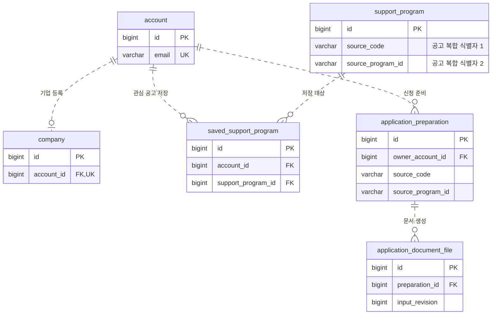

Core의 `support_program`은 Catalog에서 받은 **조회용 복제본**입니다.
`(source_code, source_program_id)`와 관심 공고의 `(account_id, support_program_id)`에는 각각 복합 UNIQUE 제약이 있습니다.
신청 준비는 공고의 복합 식별자를 저장하지만 `support_program`에 대한 FK는 두지 않습니다.
세션·협업·리포트·작업 큐 등 나머지 테이블과 전체 컬럼은 [Core Flyway migration](backend/core-service/src/main/resources/db/migration)에서 관리합니다.

### 6.3 Catalog MySQL: 공고 원본·수집·공개 상태

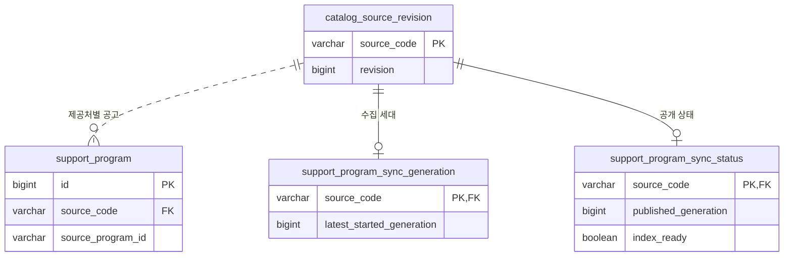

Catalog가 공고 원본과 제공처별 수집·공개 버전을 소유합니다.
공고의 `(source_code, source_program_id)`는 복합 UNIQUE이며, Core와 Catalog의 숫자 `id`가 같다고 가정하지 않습니다.
독립 카탈로그 식별용 `catalog_instance`와 전체 컬럼은 [Catalog Flyway migration](backend/catalog-service/src/main/resources/db/migration)에 정의되어 있습니다.

### 6.4 Ops MySQL: 평가·검토·비교 기준·예산

Ops는 읽기 쉽도록 **Django 모델 이름**으로 표시했습니다. FK 컬럼은 실제 저장되는 `_id` 이름입니다.

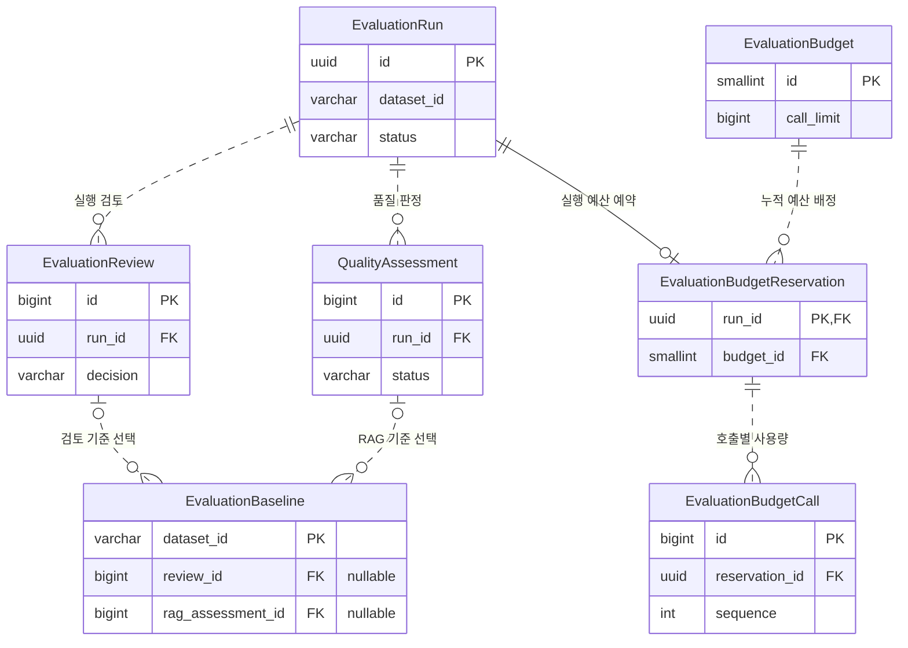

비교 기준은 자료별로 검토 또는 RAG 품질 판정 중 하나를 선택하며, 해제하면 두 참조를 비워 이력·버전을 유지합니다.
사례별 검토·정기 일정·변경 이력과 전체 제약은 [Ops 모델](backend/ops-service/apps/evaluations/models.py)과
[Django migration](backend/ops-service/apps/evaluations/migrations)에 정의되어 있습니다.
Qdrant·Elasticsearch·Redis와 평가 결과 파일의 연결은 [서비스 연결도](#서비스-연결)에서 확인할 수 있습니다.

<a id="데이터-준비"></a>

## 7. 공고 수집·색인 준비·동기화

### 7.1 공식 공고 데이터

| 제공처 | 수집 자료 | 식별 코드 |
|---|---|---|
| 기업마당 | 중앙부처·지자체·공공기관 기업지원사업 | `BIZINFO` |
| K-Startup | 창업지원사업 | `KSTARTUP` |
| 과학기술정보통신부 | 과학기술·연구개발 사업 | `MSIT` |
| 충남 온라인수출지원시스템 | 충청남도 기업 수출지원사업 | `CNTRADE_NOTICE` |

Catalog가 공식 API의 제목·기관·신청 기간·지역·분야·지원 대상·원문 URL·신청 경로를 정규화합니다.
공고는 **제공처 코드 + 원본 ID**로 구분하고, 접수 상태는 신청 기간과 서울 기준 현재 날짜로 계산합니다.


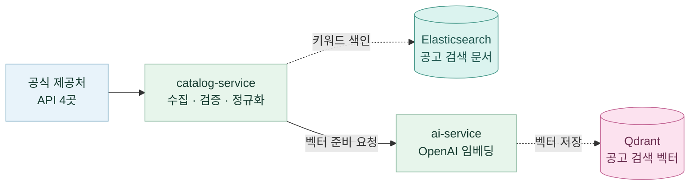


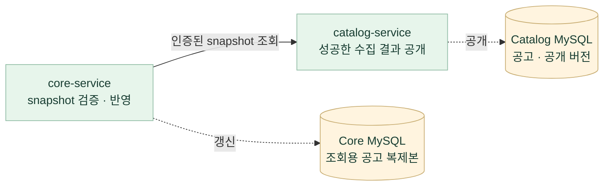

**공고 목록 갱신 방식:** 제공처의 전체 목록을 정상적으로 수집하고 응답 검증·검색 색인 준비까지 끝나면,
기존 공고는 새 내용으로 갱신하고 처음 보는 공고는 추가합니다. 이번 전체 목록에서 사라진 공고는
DB에서 삭제하지 않고 **현재 공고 목록·검색에서 제외되도록 표시**합니다. 이를 비활성화라고 합니다.

[Catalog 구현·계약](backend/catalog-service/README.md) · [서비스 분리 설명](docs/catalog-service-extraction.md) ·
[한국어 키워드 검색](docs/elasticsearch-lexical-search.md)

<a id="ai-처리-흐름"></a>

## 8. 주요 AI 기능의 처리 흐름

### 8.1 AI 대화 검색

AI가 제안한 조건을 사용자가 확인하면, 키워드·의미 검색으로 공고 후보를 찾고 AI가 추천합니다.
공고 정보는 **Core MySQL**, 키워드 검색은 **Elasticsearch**, 의미 검색은 **Qdrant**를 사용합니다.

<table width="100%">
  <tr>
    <td align="center" valign="top" width="50%">
      <strong>① 질문 입력</strong><br>
      <a href="docs/assets/screenshots/ai-search/01-new-question.jpg">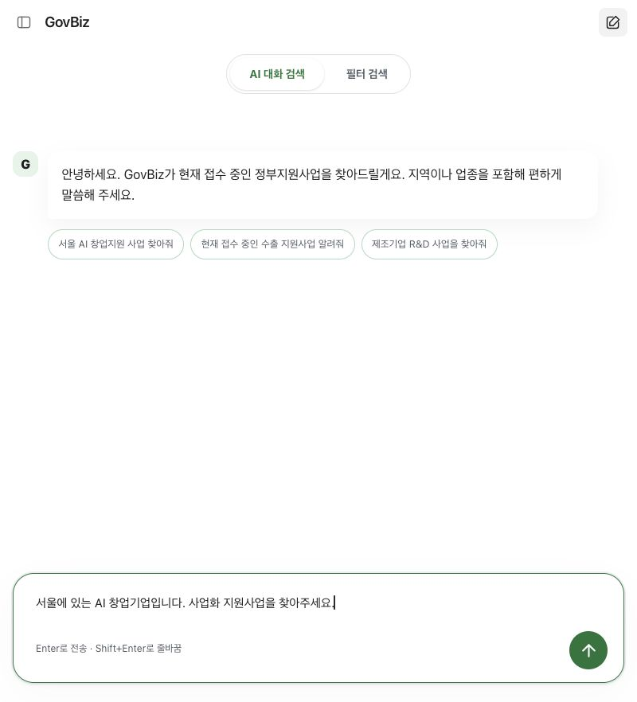</a><br>
      회사 조건과 필요한 지원을 입력합니다.
    </td>
    <td align="center" valign="top" width="50%">
      <strong>② 조건 확인</strong><br>
      <a href="docs/assets/screenshots/ai-search/02-confirm-conditions.jpg">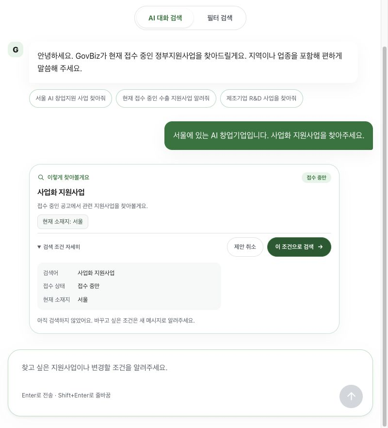</a><br>
      제안된 조건을 확인하고 검색합니다.
    </td>
  </tr>
  <tr>
    <td align="center" valign="top" width="50%">
      <strong>③ 추천 결과</strong><br>
      <a href="docs/assets/screenshots/ai-search/03-new-recommendations.jpg">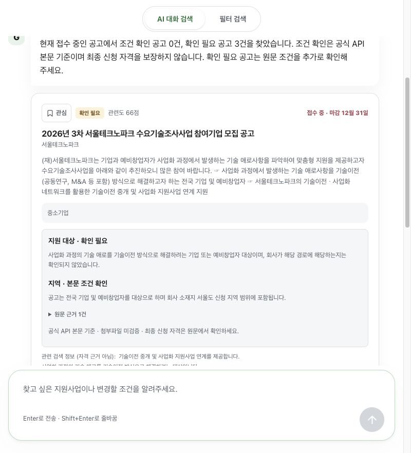</a><br>
      추천 공고와 확인 필요 사항을 봅니다.
    </td>
    <td align="center" valign="top" width="50%">
      <strong>④ 원문 근거 확인</strong><br>
      <a href="docs/assets/screenshots/ai-search/04-source-evidence.jpg">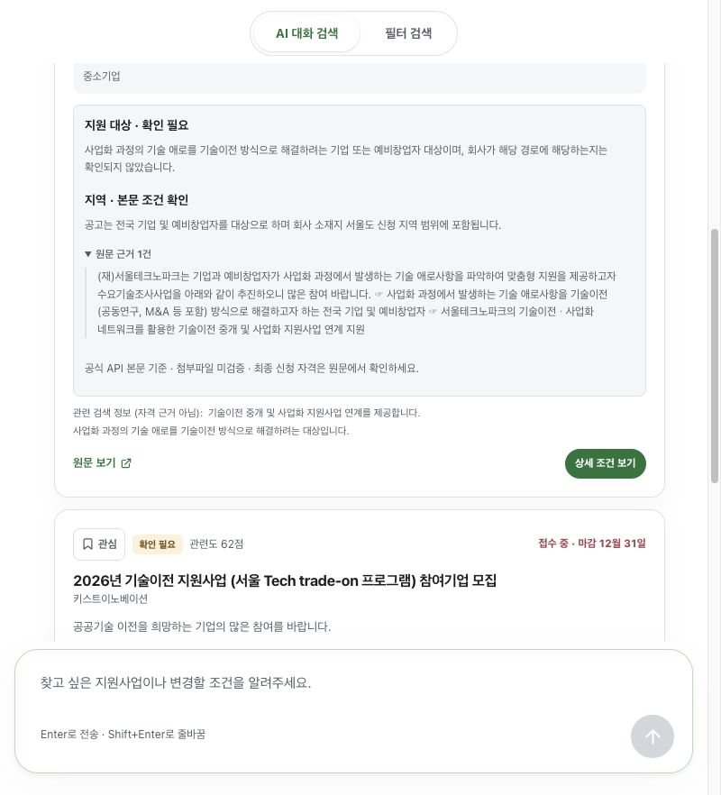</a><br>
      인용 근거를 펼치고 공식 공고를 확인합니다.
    </td>
  </tr>
</table>


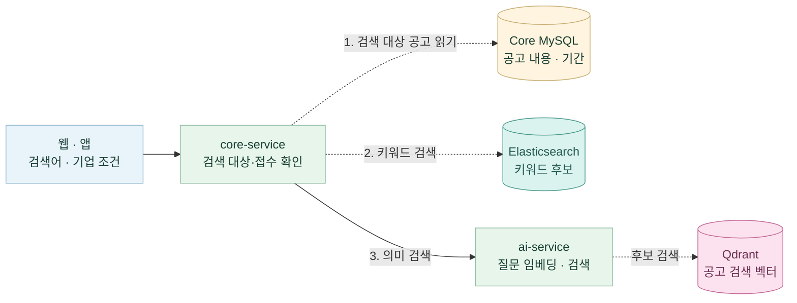

**1번은 검색에 사용할 공고를 준비하는 단계입니다.** `core-service`는 Core MySQL에서 현재 검색 가능한
공고 목록과 내용을 읽어 메모리에 보관하고, ‘접수 중만’ 조건을 적용합니다. 2·3번에서는 이 공고들을
대상으로 키워드·의미 검색을 수행해 관련 공고 ID를 찾습니다. 찾은 ID는 처음 읽어 둔 공고 내용과 연결합니다.


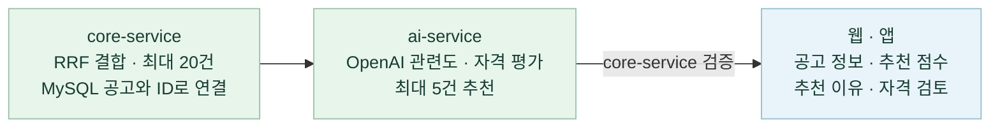

두 검색의 결과는 **제공처 코드 + 원본 ID**로 연결합니다. 예를 들어 `BIZINFO:123`이 양쪽 검색에 나오면
하나의 후보로 합치고, **RRF**로 두 검색의 순위를 결합합니다. 선택한 ID에 해당하는 공고 내용은
처음 읽어 둔 MySQL 데이터에서 찾아 AI 평가에 전달하므로, 검색 후 공고마다 DB를 다시 조회하지 않습니다.
두 색인 모두 현재 MySQL 공고의 ID·내용 버전을 기준으로 검색 범위를 제한하고 결과를 검증합니다.

| 최종 응답에 포함되는 내용 | 데이터 출처 |
|---|---|
| 제목·기관·설명·지원 대상·신청 기간·신청 경로·원문 링크 | Core MySQL에서 읽어 둔 공고 정보 |
| 접수 상태 | 저장된 신청 기간과 서울 기준 현재 날짜로 계산 |
| 추천 점수·추천 이유·자격 검토 결과 | 후보 공고에 대한 이번 검색의 AI 평가 결과를 `core-service`가 검증해 추가 |

사용자 검색은 미리 동기화된 **Core MySQL**을 사용하며 Catalog MySQL을 직접 조회하지 않습니다.
최종 추천은 최대 5건으로, 기준에 맞는 공고가 없으면 더 적거나 0건일 수 있습니다. 비로그인 사용자에게는 최대 2건을 먼저 표시합니다.
검색어가 없으면 키워드·의미 검색과 AI 평가를 생략하고, MySQL 공고를 최신순으로 최대 5건 반환합니다.
상세 공고 질문에서 원문 청크를 찾는 Qdrant 검색은 아래 [근거 기반 답변 흐름](#공고-상세의-근거-기반-답변rag)에서 별도로 설명합니다.

<a id="공고-상세의-근거-기반-답변rag"></a>

### 8.2 공고 상세의 근거 기반 답변(RAG)

RAG는 **검색한 공식 원문을 모델에게 함께 전달해 답변의 근거로 사용하는 방식**입니다.
현재 상세 공고 질문은 기업마당·K-Startup 공식 HTML 본문을 사용합니다.


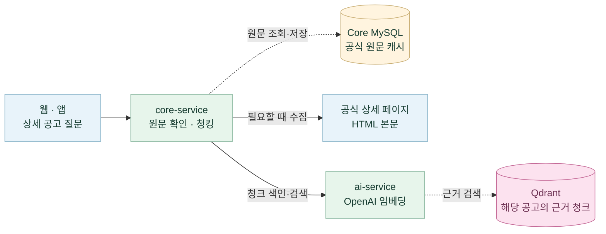


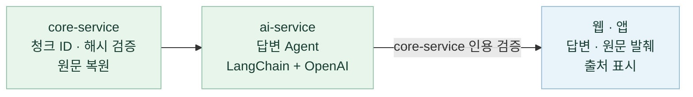

근거가 부족한 질문은 확인할 수 없다고 안내하고, 외부 서비스 장애는 오류로 반환합니다.
상세 공고의 HTML 질문과 신청 문서의 첨부파일 분석은 입력·처리 경로가 다릅니다.

### 8.3 신청 문서 작성

공식 첨부 양식에 **사용자가 입력한 답변을 기입하고 초안을 내려받는 기능**입니다.

<table width="100%">
  <tr>
    <td align="center" valign="top" width="50%">
      <strong>① 공고 선택</strong><br>
      <a href="docs/assets/screenshots/application-documents/01-program-selection.jpg">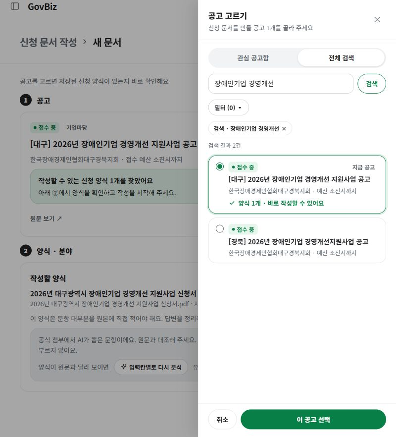</a><br>
      관심 공고함이나 전체 검색에서 작성할 공고를 고릅니다.
    </td>
    <td align="center" valign="top" width="50%">
      <strong>② 양식 확인</strong><br>
      <a href="docs/assets/screenshots/application-documents/02-form-confirmation.jpg">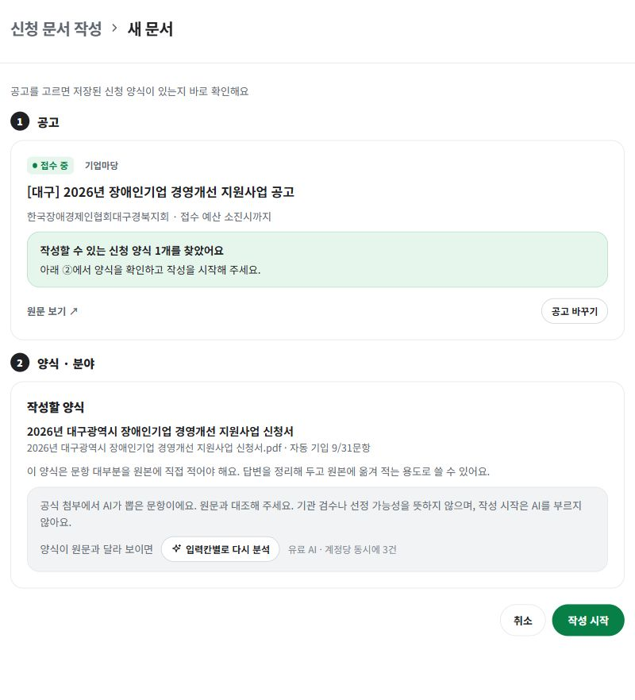</a><br>
      공식 첨부 양식과 자동 기입 범위를 확인합니다.
    </td>
  </tr>
  <tr>
    <td align="center" valign="top" width="50%">
      <strong>③ 답변 작성</strong><br>
      <a href="docs/assets/screenshots/application-documents/03-answer-entry.jpg">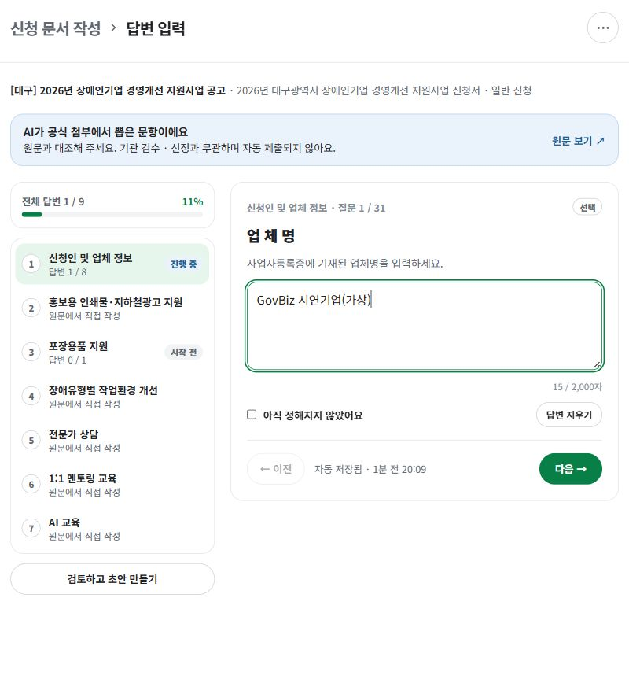</a><br>
      문항별로 답변을 입력하고 자동으로 저장합니다.
    </td>
    <td align="center" valign="top" width="50%">
      <strong>④ 답변 검토</strong><br>
      <a href="docs/assets/screenshots/application-documents/04-answer-review.jpg">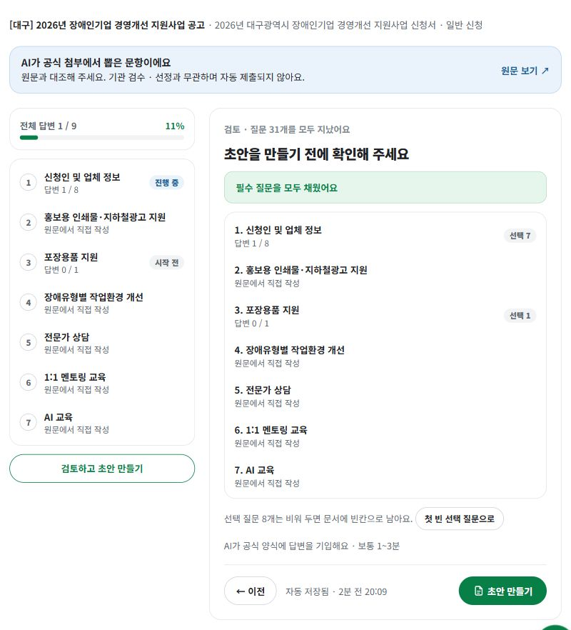</a><br>
      작성 현황과 비어 있는 문항을 확인한 뒤 초안을 요청합니다.
    </td>
  </tr>
  <tr>
    <td align="center" valign="top" width="50%">
      <strong>⑤ 생성 결과·다운로드</strong><br>
      <a href="docs/assets/screenshots/application-documents/05-generation-result.jpg">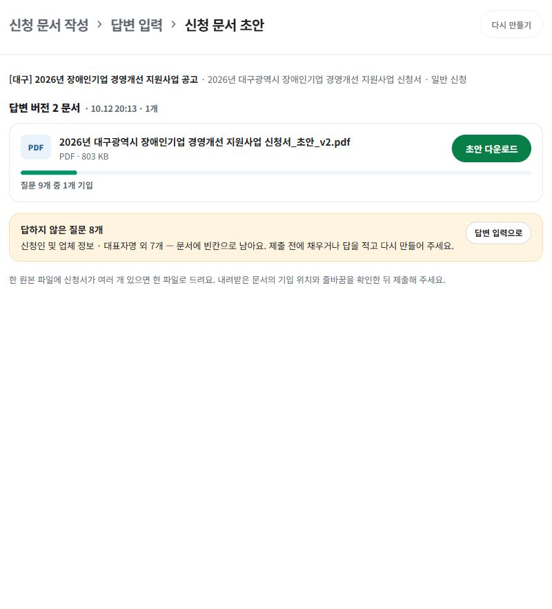</a><br>
      생성된 파일과 기입 현황을 확인하고 초안을 내려받습니다.
    </td>
    <td align="center" valign="top" width="50%">
      <strong>⑥ 실제 기입 문서</strong><br>
      <a href="docs/assets/screenshots/application-documents/06-filled-document.jpg">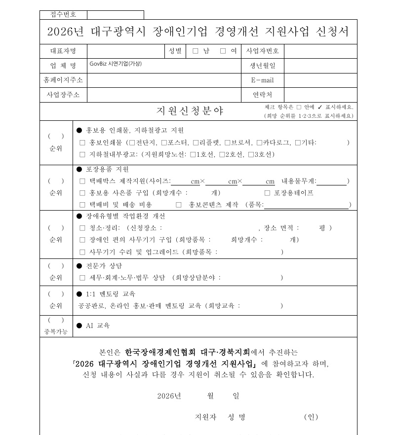</a><br>
      내려받은 문서의 입력 위치와 내용을 확인합니다.
    </td>
  </tr>
</table>

사진은 로컬 웹에서 같은 공식 PDF 양식에 가상 회사명 1개를 입력해 생성·다운로드한 시연입니다. ⑥은 내려받은 PDF의 첫 페이지를 렌더링한 모습이며, 기관 제출이나 나머지 문항 작성 완료를 뜻하지 않습니다.


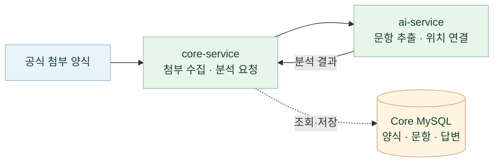


양식 조회는 저장된 분석 결과를 사용하며, 문서 생성 작업은 core-service의 워커가 실행합니다.
원본·입력 버전과 생성 결과를 검증해 파일을 Core MySQL에 저장합니다.
사용자는 초안과 자동 기입되지 않은 항목을 확인한 뒤 공식 사이트에서 최종 제출합니다.

### 8.4 GovBiz 도우미

웹 도우미가 질문을 분류해 **서비스 이용 안내, 권한 범위의 자료 조회, 관심 공고에 대한 근거 답변**을 제공합니다.


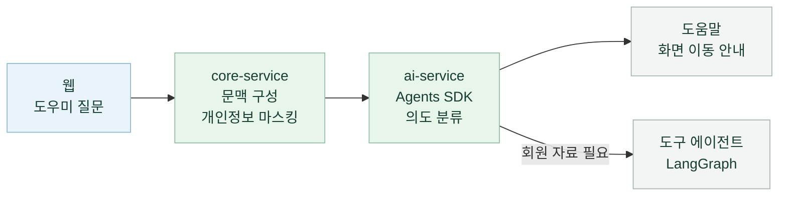


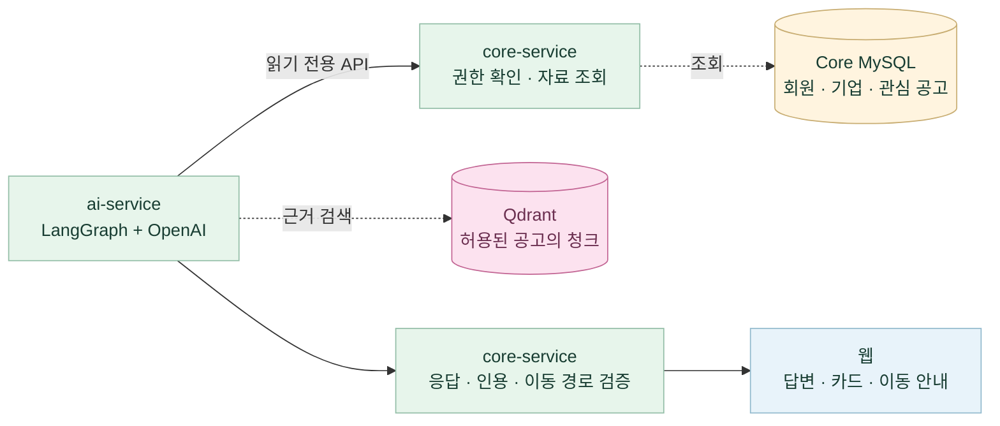

관심 공고 RAG는 core-service가 본인 관심 공고의 원문을 준비한 뒤 ai-service에 허용 청크를 전달합니다.
도움말 응답도 core-service의 검증을 거치며, 실제 검색 실행과 신청·제출은 사용자가 해당 화면에서 진행합니다.

[실제 호출 경로](docs/architecture.md) · [AI Service](backend/ai-service/README.md) ·
[문서 작성·형식별 지원 범위](docs/application-document-mcp-architecture.md)

### 8.5 관리자 Gov 에이전트

웹 `/app/chat`에서 관리자에게는 **Gov 에이전트**, 일반 회원에게는 기존 **AI 대화 검색**을 표시합니다.
검색 조건 제안·확인 후 검색, 선택 공고의 원문 근거 답변·신청 준비, 중복 지원 검토와 파트너 모집글 조회를 같은 대화에서 제공합니다.

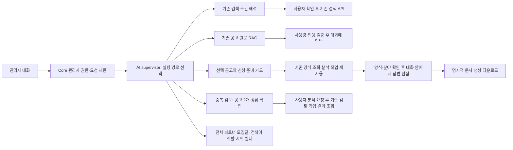

선택 공고의 원문 답변·신청 준비, 서로 다른 공고 2개의 중복 지원 검토를 같은 대화에서 이어갑니다.
파트너 모집글은 전체 목록에서 검색·필터링합니다.

분석·문서 생성은 사용자가 버튼을 눌러 시작하며, 기록을 다시 열면 저장된 결과와 현재 상태를 확인합니다.
기록 복원만으로 작업을 재실행하지 않으며, 모집글 작성·제안 전송·기관 제출·여러 단계 자동 실행은 지원하지 않습니다.

<a id="llmops-평가운영"></a>

## 9. LLMOps 평가·운영

**모델이나 프롬프트를 바꿨을 때, 같은 질문에 대한 답변 품질이 좋아졌는지 확인하는 관리자 기능**입니다.
평가 자료와 비교 대상을 고정한 뒤 결과·사용량·실패·사람의 판단을 함께 기록합니다.
예를 들어 같은 공고의 지원 대상 질문을 이전 모델과 새 모델에 적용하고,
답변에서 빠진 조건이나 잘못 인용한 근거를 확인한 후 다음 평가의 비교 기준을 정할 수 있습니다.

평가 도구는 **Langfuse + Prefect + Pandera + Evidently + pandas**로 구성하고,
**React는 운영 화면, Django는 인증·실행 관리 API**를 담당합니다.

### 9.1 다섯 도구의 역할

| 도구 | 담당하는 일 | 확인할 수 있는 결과 |
|---|---|---|
| **Langfuse** | 모델 호출과 평가 점수를 연결해 추적 | 모델·지연·토큰 사용량·오류·trace |
| **Prefect** | 평가 작업 실행과 단계·상태 관리 | 실행 상태·실패 단계·작업 로그 |
| **pandas** | 사례별 결과를 표로 정리하고 집계 | 비교·지표 계산에 사용하는 데이터 |
| **Pandera** | ID·상태·수치 범위 등 데이터 형식 검증 | 잘못된 입력·결과의 조기 거절 |
| **Evidently** | 후보와 기준의 지표를 비교해 보고서 생성 | 비교 HTML 보고서 |

프로젝트 평가기가 지표를 계산하고, Django의 품질 정책과 사람 검토로 합격·비교 기준을 결정합니다.
데이터 형식 검증이나 작업 성공만으로 답변의 정확성을 승인하지 않습니다.

### 9.2 전체 처리 흐름


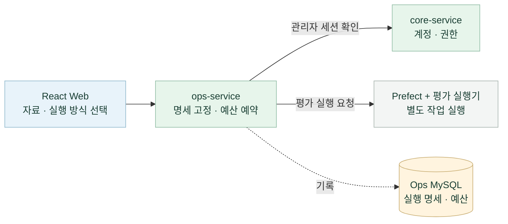

**평가 실행 요청은 관리자가 선택한 조건을 하나의 작업으로 등록해 Prefect에 전달하는 단계입니다.**
예를 들어 관리자가 저장된 답변 6건의 재평가를 요청하면, `ops-service`는 관리자 권한과
평가 자료·실행 방식·비교 대상을 확인하고 Ops MySQL에 실행 기록을 저장한 뒤 Prefect에 작업 생성을 요청합니다.
새 모델 호출이 필요한 평가에는 승인된 호출·토큰 예산도 확인하고 예약합니다.
이후 Prefect가 관리하는 별도 평가 실행기가 실제 평가와 점수·보고서 생성을 수행합니다.


```mermaid
flowchart LR
    Runner["평가 실행기<br/>한 가지 방식 선택"] --> Replay["저장 응답 재평가<br/>새 모델 호출 없음"]
    Runner --> Answer["고정 근거 새 답변<br/>OpenAI 답변 생성"]
    Runner --> Rag["새 RAG 실행<br/>질문 임베딩 · 검색 · 답변"]
    Rag -. 색인·검색 .-> Qdrant[("격리된 메모리 Qdrant<br/>평가용 청크 벡터 재사용<br/>없는 벡터만 새로 생성")]
    Replay --> Analyze["pandas + Pandera<br/>변환 · 검증 · 지표 계산"]
    Answer --> Analyze
    Rag --> Analyze
    Analyze -. 보존 .-> Artifacts[("결과 저장소<br/>답변 캡처 · 지표")]
    classDef execution fill:#f3f5f4,stroke:#a8b5af,color:#183d32
    classDef vectorDb fill:#fce2ef,stroke:#c26493,color:#6b2f50
    class Runner,Replay,Answer,Rag,Analyze,Artifacts execution
    class Qdrant vectorDb
```


```mermaid
flowchart LR
    Results["Evidently · Langfuse<br/>보고서·추적·점수"] --> Review["React Web<br/>사람 검토·기준 선택"]
    Review -->|판정·지정 요청| Ops["ops-service<br/>정책·승인 확인"]
    Ops -. 보존 .-> OpsDB[("Ops MySQL<br/>검토·판정·비교 기준")]
    classDef client fill:#e8f3fa,stroke:#91b9cd,color:#183d32
    classDef service fill:#e7f5eb,stroke:#92bda6,color:#183d32
    classDef execution fill:#f3f5f4,stroke:#a8b5af,color:#183d32
    classDef mysql fill:#fff4df,stroke:#c8ad72,color:#183d32
    class Results execution
    class Review client
    class Ops service
    class OpsDB mysql
```

1. **관리자 실행 요청:** 기존 Core 관리자 계정으로 로그인하고 React의 `/ops/evaluations`에서
   자료·실행 방식·비교 대상을 선택합니다. Django Ops가 관리자 권한과 실행 명세를 확인하고,
   새 모델 호출이 있으면 승인된 호출·토큰 한도를 검사해 예산을 예약합니다.
2. **평가 실행:** Prefect가 별도 평가 실행기에 작업을 전달하고, 실행기는 9.3에서 선택한 방식으로 평가합니다.
   Django의 HTTP 요청 안에서 모델 평가를 수행하지 않습니다.
3. **결과 분석:** 실행기는 **pandas**로 데이터를 정리하고 **Pandera**로 형식을 검증해 지표를 계산합니다.
   **Evidently**는 비교 보고서, **Langfuse**는 모델 호출 추적·사용량 관측·평가 점수를 제공합니다.
   호출 추적은 실행 중에도 수집하며, 과거 저장 응답에 없던 trace를 새로 만들지는 않습니다.
4. **사람 검토와 기준 지정:** 관리자가 자료와 사례별 답변을 검토하고 실행 검토를 승인합니다.
   검토 기록과 품질 정책으로 판정한 뒤, 합격한 결과를 관리자가 비교 기준으로 지정합니다.
   다음 평가에서는 같은 자료의 이 기준과 새 결과를 비교합니다.

### 9.3 세 가지 평가 방식

**화면에서 세 가지 실행 경로 선택하기**

관리자 메뉴의 **새 평가**(`/ops/evaluations/new`)에서 **실행 방식**과 **평가 자료**를 함께 선택합니다.
실행 방식 메뉴에는 `저장 응답 재평가`와 `새 응답 생성` 두 옵션이 있으며,
새 응답 생성은 선택한 자료가 **고정 근거 답변 자료인지 RAG 자료인지**에 따라 두 경로로 나뉩니다.
①은 공통 진입 화면이며, ②~④는 실행 목적에 따라 선택하는 세 가지 예시입니다.

<table width="100%">
  <tr>
    <th width="50%">① 새 평가 화면 열기</th>
    <th width="50%">② 저장 응답 재평가</th>
  </tr>
  <tr>
    <td align="center" valign="top">
      <a href="docs/assets/screenshots/evaluation-modes/00-new-evaluation.jpg">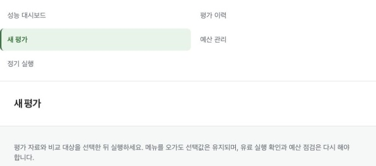</a>
    </td>
    <td align="center" valign="top">
      <a href="docs/assets/screenshots/evaluation-modes/01-replay.jpg">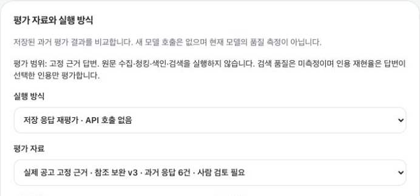</a>
    </td>
  </tr>
  <tr>
    <td valign="top">
      <strong>공통 시작:</strong> 관리자 메뉴 → 새 평가<br><br>
      평가 자료와 실행 방식, 비교 대상을 선택하는 화면입니다. 목적에 따라 나머지 세 컷 중 하나의 조합을 선택합니다.
    </td>
    <td valign="top">
      <strong>선택:</strong> 저장 응답 재평가 · API 호출 없음<br><br>
      저장된 기준·후보의 답변·검색 결과로 지표와 비교 보고서를 다시 생성합니다. 새 모델 호출은 없으며, 과거 응답은 당시 모델의 기록으로 표시합니다.
    </td>
  </tr>
  <tr>
    <th width="50%">③ 고정 근거로 새 답변 생성</th>
    <th width="50%">④ 고정 원문으로 새 RAG 실행</th>
  </tr>
  <tr>
    <td align="center" valign="top">
      <a href="docs/assets/screenshots/evaluation-modes/02-fixed-context-live.jpg">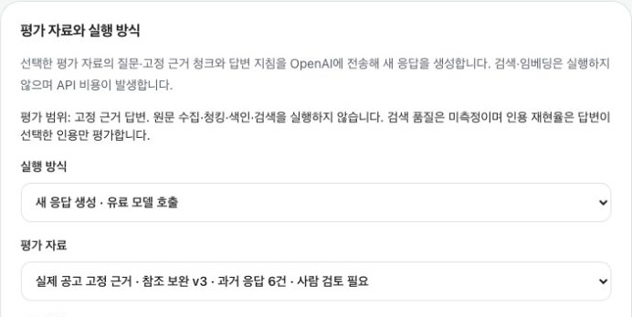</a>
    </td>
    <td align="center" valign="top">
      <a href="docs/assets/screenshots/evaluation-modes/03-rag-live.jpg">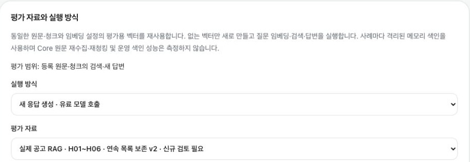</a>
    </td>
  </tr>
  <tr>
    <td valign="top">
      <strong>선택:</strong> 새 응답 생성 + 고정 근거 답변 자료<br><br>
      사진의 <strong>실제 공고 고정 근거 · 참조 보완 v3</strong>처럼 같은 질문·근거에서 모델이나 프롬프트 변경의 영향을 비교합니다. OpenAI로 답변만 새로 생성하며 검색·임베딩은 실행하지 않습니다.
    </td>
    <td valign="top">
      <strong>선택:</strong> 새 응답 생성 + RAG 평가 자료<br><br>
      사진의 <strong>실제 공고 RAG · 연속 목록 보존 v2</strong>처럼 평가용 청크 벡터를 준비하고 격리된 Qdrant에서 검색한 뒤 새 답변을 생성합니다. 같은 자료의 저장 벡터는 재사용하고 없는 벡터만 새로 만듭니다.
    </td>
  </tr>
</table>

사진은 실행 전 선택 화면입니다. 새 응답 생성은 서버의 실행 설정·예산 점검과 자료 전송·호출 예산 확인 후 요청합니다.
세 경로의 결과는 9.2의 공통 지표 계산으로 이어집니다. 저장 응답 재평가는 현재 모델의 품질을 새로 측정하지 않습니다.

**새 RAG 실행의 벡터 재사용**

청크 벡터는 기존 평가 결과 저장소에 보존하고, 실행할 때 메모리 Qdrant에 복원합니다.
운영 Qdrant의 공고 벡터를 가져오는 방식이 아니라 **평가 자료 전용 벡터를 재사용**하는 방식입니다.
같은 자료로 답변 모델이나 프롬프트를 비교할 때 문서 임베딩을 반복하지 않아 검색 조건을 유지하고 호출을 줄입니다.

| 조건 | 청크 벡터 준비 | 매번 새로 실행하는 부분 |
| --- | --- | --- |
| 처음 평가하는 자료 | 없는 벡터를 생성·저장. 같은 문서를 쓰는 사례끼리 공유 | 질문 임베딩 → 검색 → 답변 |
| 동일한 원문·청크·임베딩 설정 | 저장한 벡터 재사용 | 질문 임베딩 → 검색 → 답변 |
| 원문·청크·임베딩 모델·차원·전처리 변경 | 새 식별자의 벡터 생성·저장 | 질문 임베딩 → 검색 → 답변 |

새 평가 화면의 **청크 벡터 준비 계획**에서 사례별 재사용·생성 여부와 그에 따른 호출·토큰 상한을 확인합니다.
예를 들어 등록된 H01~H06 RAG 자료는 최초 실행에 최대 **14회**(문서 2 + 질문 6 + 답변 6),
같은 벡터를 재사용하면 최대 **12회**(질문 6 + 답변 6)를 예약합니다. 답변 전 입력 토큰 계산 요청은 별도로 기록합니다.
접수한 재사용 파일이 없어지거나 변경되면 추가 임베딩으로 대체하지 않고 중단합니다.

새 RAG 실행은 **등록된 고정 원문·청크의 검색·답변**을 평가하며, 검색·인용·답변 지표를 구분합니다.
공식 원문 재수집·Core 재청킹·운영 검색 색인의 성능은 포함하지 않습니다.
벡터 최초 생성 비용과 재사용 시 비용, 자동 지표와 사람의 답변 검토는 각각 구분해 기록·해석합니다.

Core HTTP의 저장 실행 기록도 요청·원문·검색·인용을 대조한 뒤 재평가 목록에 등록할 수 있습니다.
무료 AI 대역과 당시 실제 모델의 저장 응답을 구분하며, 이 등록·재평가로 새 모델을 호출하지 않습니다.
[Core HTTP 기록 연결](evaluation/support-program-evidence/README.md#core-http-기록을-ops-rag-평가에-연결)

### 9.4 운영 화면에서 할 수 있는 일


```mermaid
flowchart LR
    Manual["수동 평가<br/>자료 · 방식 선택"] --> Check["실행 설정·예산 확인<br/>유료 호출 시 승인 · 예약"]
    Schedule["정기 평가<br/>일정 등록 · 중지"] -->|활성 일정| Check
    Check -->|조건 충족| Run["평가 실행<br/>진행 상태 조회"]
    Run -->|완료·실패| History["실행 이력<br/>결과 · 사용량 보존"]
    Run -->|취소 요청| Cancel["후속 호출 중단<br/>발생 사용량 유지"]
    Cancel --> History
    classDef client fill:#e8f3fa,stroke:#91b9cd,color:#183d32
    classDef service fill:#e7f5eb,stroke:#92bda6,color:#183d32
    classDef execution fill:#f3f5f4,stroke:#a8b5af,color:#183d32
    class Manual,Schedule,History client
    class Check service
    class Run,Cancel execution
```


```mermaid
flowchart LR
    History["실행 이력 선택<br/>결과 · 실패 단계 확인"] -->|완료| Review["보고서·근거·답변 확인<br/>자료 · 사례별 검토"]
    History -->|응답 저장·후처리 실패| Recovery["캡처 검증·후처리 복구<br/>새 모델 호출 없음"]
    Recovery -->|복구 완료| Review
    Review --> Quality["실행 검토 승인<br/>품질 판정"]
    Quality -->|합격 후 관리자 지정| Baseline["비교 기준 지정<br/>다음 평가에 사용"]
    classDef client fill:#e8f3fa,stroke:#91b9cd,color:#183d32
    classDef service fill:#e7f5eb,stroke:#92bda6,color:#183d32
    classDef execution fill:#f3f5f4,stroke:#a8b5af,color:#183d32
    class History,Review,Baseline client
    class Quality service
    class Recovery execution
```

### 9.5 기능별 상세설명

| 기능 | 동작 |
|---|---|
| 평가 실행·이력 조회 | 실행 전 설정과 예산을 확인하고 요청합니다. 진행 상태·실패 단계·결과·사용량·비교 보고서를 조회하며, 같은 요청 재전송으로 실행을 중복 생성하지 않습니다. |
| 근거와 답변 검토 | 질문·원문·참조 조건·후보 답변을 대조하고 사례별 판단과 사유를 저장합니다. RAG는 검색된 근거와 답변의 인용도 함께 확인합니다. |
| 품질 판정·비교 기준 | 자료 검토, 사례 검토, 실행 승인, 품질 판정과 기준 변경 이력을 보존합니다. 필요한 사람 검토가 없으면 합격·기준 지정을 차단합니다. |
| 예산·취소 | 누적·일별 호출 수와 입력·출력 토큰 한도를 관리합니다. 동시 요청에도 예약량을 합산하고, 사용량이 불명확한 호출을 0으로 정산하지 않습니다. 취소는 후속 호출을 중단하며 이미 발생한 사용량은 남습니다. |
| 실패 후처리 복구 | 모델 응답은 저장됐지만 보고서·점수 등록이 실패한 경우, 검증된 캡처로 후처리를 다시 실행합니다. 새 모델 호출 없이 원본 실패와 복구 이력을 함께 보존합니다. |
| 정기 평가 | 종료일이 있는 일별 일정을 등록·중지할 수 있습니다. 기본값은 비활성화이며, 활성화해도 동일한 승인·예산 검사를 거칩니다. |

**`COMPLETED`는 평가 작업 완료이며 품질 합격을 뜻하지 않습니다.**
품질 합격과 비교 기준 지정은 별도 단계이고, 기준은 사람이 검토한 자료 범위에서만 유효합니다.

<a id="저장소-구성"></a>

## 10. 저장소 구성

애플리케이션·평가 도구·Kubernetes 설정을 함께 관리하는 모노레포입니다.
기준 저장소는 [`SKNETWORKS-FAMILY-AICAMP/SKN34-4th-1Team`](https://github.com/SKNETWORKS-FAMILY-AICAMP/SKN34-4th-1Team), 기본 브랜치는 `main`입니다.
별도 submodule이나 두 번째 clone은 필요하지 않습니다. 서비스 프로세스·의존성·DB 책임은 분리합니다.

```text
SKN34-4th-1Team/
├─ frontend/
│  ├─ web/                   React 웹·관리자·LLMOps 화면
│  ├─ mobile/                Expo·React Native 앱
│  └─ packages/shared/       공통 업무 모델·API 계약·응답 검증
├─ backend/
│  ├─ core-service/          공개 API·사용자 업무
│  ├─ catalog-service/       공고 수집·원본·색인 공개
│  ├─ ai-service/            내부 검색·AI·문서 도구
│  └─ ops-service/           평가 운영 API·전용 DB
├─ evaluation/               검색·근거 답변·문서 등의 평가 자료·실행기
├─ infrastructure/
│  ├─ llmops/                Langfuse·Prefect·실행기·복구 도구
│  ├─ gitops/                Helm·kind·인프라 검증·기존 Argo 설정
│  └─ …                      Compose·이미지 발행·기존 AWS 배포 템플릿
├─ .github/workflows/        앱·Catalog·Ops·LLMOps·인프라 CI
├─ docs/                     기능·운영 안내와 구조도·검증 기록
├─ output/pdf/               LLMOps 사용자 가이드
├─ pnpm-workspace.yaml       웹·모바일·공통 패키지 workspace
└─ compose.yaml              로컬 통합 개발 진입점
```

<a id="문서-안내"></a>

## 11. 문서 안내

| 보고 싶은 내용 | 문서 |
|---|---|
| 전체 문서·이전 프로젝트 결과 | [문서 목록](docs/README.md) · [기술 README](docs/technical-readme.md) · [3차 프로젝트 README](docs/third-project/README.md) |
| 실행·데이터 이전 | [로컬 시작](docs/local-start.md) · [통합 Compose](docs/ops-monorepo-migration.md) · [Catalog 분리](docs/catalog-service-extraction.md) · [모노레포 통합 배경](docs/repository-integration.md) |
| 서비스 설계·호출 흐름 | [계층·책임](docs/architecture/README.md) · [호출·데이터 흐름](docs/architecture.md) · [기술·저장소 상세](docs/technology.md) |
| 웹·모바일 | [웹](frontend/web/README.md) · [모바일](frontend/mobile/README.md) · [공통 코드](docs/mobile-monorepo.md) · [앱 푸시](docs/mobile-report-push.md) |
| 백엔드 | [Core](backend/core-service/README.md) · [Catalog](backend/catalog-service/README.md) · [AI](backend/ai-service/README.md) · [Ops](backend/ops-service/README.md) |
| 신청 문서·중복 검토 | [문서 작성 구조·형식별 경계](docs/application-document-mcp-architecture.md) · [문서 도구 실행](docs/application-document-mcp-setup.md) · [중복 검토](docs/duplicate-support-review-design.md) |
| LLMOps | [사용 가이드 PDF](output/pdf/govbiz-llmops-user-guide-ko.pdf) · [실행 환경](infrastructure/llmops/README.md) · [평가 자료·지표](evaluation/support-program-evidence/README.md) · [검토 기록 재사용](docs/ops-local-review-copy.md) · [갱신·백업·복구](docs/ops-upgrade-runbook.md) |
| Kubernetes·이미지 | [현재 지원 경로](infrastructure/gitops/README.md) · [개인 개발](docs/local-fork-development.md) · [이미지 발행](docs/msa-image-release.md) · [Windows 설치](docs/windows-kubernetes-setup.md) |

각 검증 문서의 날짜·대상 커밋·환경을 함께 확인하세요. 과거 모델의 평가 결과나 배포 성공 기록을
현재 모델·모든 실행 환경의 검증 결과로 해석하지 않습니다.
