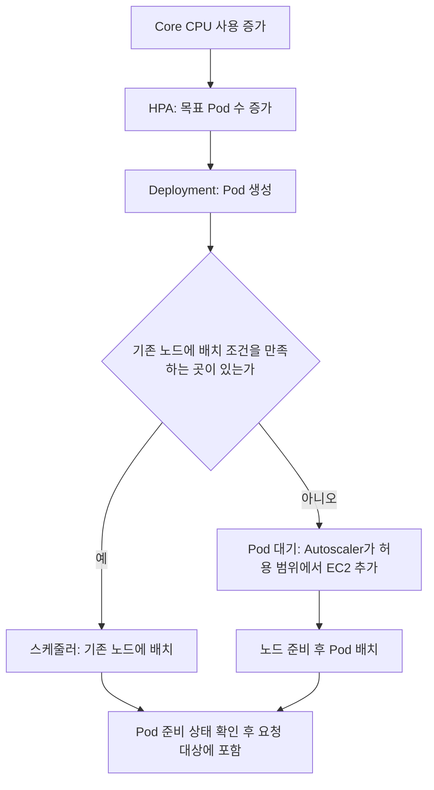

# GovBiz에서 Docker Compose와 Kubernetes를 사용하는 이유

[메인 README](../README.md) · [문서 안내](README.md) · [EKS 전체 구성도](assets/architecture/README-aws-eks.md)

2026-10-12에 나눈 컨테이너 복구·서비스 확장·EC2 배치·로드밸런싱·무중단 배포 질문을 정리한 문서입니다.
프로젝트 설정은 `skn-472`의 구현 커밋 `10a5b625`와 기록 커밋 `168818a6`을 기준으로 설명합니다.
실시간 Pod 수나 최신 배포 성공 여부를 나타내는 대시보드는 아닙니다.

**Compose도 컨테이너 재시작, 서비스별 개수 조절, 원격 배포, 상태 확인을 할 수 있습니다.**
ALB·배포 스크립트 등을 연결하면 서버 장애 대응과 무중단 배포도 구현할 수 있습니다.
Kubernetes의 이점은 여러 서버에 걸친 **배치·복구·교체를 원하는 상태에 맞춰 계속 관리하고,
자동 확장 도구와 연결할 수 있는 공통 운영 체계**에 있습니다. 모든 프로젝트에 필수인 도구는 아닙니다.

이 문서에서 Compose는 일반 Docker Engine에 `docker compose`로 실행하는 구성을 뜻합니다.
Swarm·ECS 또는 별도의 운영 자동화를 추가한 구성까지 Compose 기본 기능으로 묶어 비교하지 않습니다.

## 1. 질문별 비교

| 질문 | Docker Compose | Kubernetes와 설정한 운영 도구 |
|---|---|---|
| 컨테이너가 종료되면 다시 실행할 수 있나? | 가능. Docker 재시작 정책 필요 | 가능. 재시작 정책에 따라 컨테이너 재시작, 컨트롤러가 관리하는 Pod의 부족분 재생성 |
| Core만 1개에서 3개로 늘릴 수 있나? | 가능. `--scale` 등으로 서비스별 개수 지정 | 가능. Deployment 개수 조절 또는 HPA 사용 |
| CPU 부하에 따라 자동으로 늘릴 수 있나? | 기본 명령만으로는 안 됨. 별도 감시·제어 필요 | HPA와 메트릭 수집 설정으로 가능 |
| 한 PC에서 여러 EC2를 관리할 수 있나? | 가능. 원격 Docker 대상별로 명령 실행 | 클러스터 API를 통해 리소스 관리 |
| 여러 EC2 중 실행할 곳을 자동 선택하나? | 기본 기능에는 클러스터 스케줄러가 없음 | 스케줄러가 자원·배치 조건에 맞는 노드 선택 |
| EC2 장애 시 다른 EC2에 대체 실행하나? | 별도 자동화 필요 | 컨트롤러가 대체 Pod를 만들고 조건이 맞는 정상 노드에 배치. 시간·자원·저장소 제약 존재 |
| 서비스를 따로 업데이트하고 상태를 볼 수 있나? | 가능. `up`, `ps`, `logs`, healthcheck 등 | 가능. Deployment·Pod·이벤트·로그·rollout 상태 등 |
| 무중단 배포가 가능한가? | 가능. 새 버전 준비·트래픽 전환·기존 버전 종료 절차 필요 | 롤링 교체·readiness 등을 설정해 구현. 설치만으로 보장되지는 않음 |

아래 각 절에서 전제 조건과 GovBiz의 실제 적용 범위를 설명합니다.

## 2. 컨테이너가 죽으면 Compose도 다시 살릴 수 있다

Compose 서비스에 `restart: unless-stopped` 같은 정책을 지정하면 Docker가 종료된 컨테이너를
같은 호스트에서 다시 실행할 수 있습니다. 사람이 명시적으로 중지한 컨테이너는 이 정책으로
임의 재개하지 않습니다. 재시작 정책이 없으면 기본값은 `no`입니다.
[Docker 재시작 정책](https://docs.docker.com/engine/containers/start-containers-automatically/)

다음 상황은 구분해야 합니다.

- **프로세스 종료:** 설정된 재시작 정책으로 복구할 수 있습니다.
- **프로세스는 살아 있지만 응답 불가:** Compose의 healthcheck가 `unhealthy`로 표시하는 것만으로
  Docker가 자동 재시작하지는 않습니다.
- **EC2 자체의 장애:** 그 EC2의 Docker도 작동하지 못하므로 같은 호스트의 재시작 정책으로 해결할 수 없습니다.

Kubernetes에서는 kubelet이 컨테이너 재시작을 담당합니다. 설정된 liveness probe가 실패하면
컨테이너를 재시작할 수 있고, readiness probe가 실패하면 일반적인 Service 요청 대상에서 제외합니다.
readiness 실패 자체가 재시작 명령은 아닙니다. Deployment 등이 관리하는 Pod가 사라지면
컨트롤러가 새 Pod를 만들어 필요한 수를 맞춥니다.
[Kubernetes 복구](https://kubernetes.io/docs/concepts/architecture/self-healing/) ·
[상태 검사](https://kubernetes.io/docs/concepts/workloads/pods/probes/)

GovBiz의 [개발용 Compose](../infrastructure/compose.yaml)는 Core·AI에 재시작 정책을 지정하지 않았습니다.
[과거 운영 Compose](../infrastructure/compose.prod.yaml)는 공통 설정에 `unless-stopped`를 사용합니다.
따라서 **Compose의 지원 기능과 특정 파일에 실제 적용된 설정은 구분**해야 합니다.

## 3. Compose를 EC2 3대에서 실행하면 한 대가 고장 나도 괜찮은가

세 EC2에 같은 API가 준비돼 있고, ALB가 정상 서버로 요청을 보내며, 남은 서버의 처리 용량과
DB·세션·파일 접근이 유지된다면 서비스를 계속 제공할 수 있습니다. Kubernetes만 가능한 구조가 아닙니다.
EC2 Auto Scaling Group에 새 서버의 Compose 기동 절차를 연결하는 방식도 가능합니다.
[AWS Auto Scaling과 로드밸런서 연결](https://docs.aws.amazon.com/autoscaling/ec2/userguide/attach-load-balancer-asg.html)

하지만 **EC2 개수가 3개라는 사실만으로 같은 기능이 3중화되지는 않습니다.**
예를 들어 A는 API, B는 유일한 DB, C는 관리 도구를 실행한다면 B의 장애는 API에도 영향을 줍니다.

Kubernetes도 장애를 감지하고 대체 Pod를 준비하는 시간이 필요합니다. 정상 노드에 필요한 자원과
배치 조건이 맞아야 하며, 데이터 볼륨에 접근할 수 있어야 합니다. 기존 Pod가 실행 중인 상태 그대로
다른 노드로 이동하는 것은 아닙니다. 진행 중 요청이나 메모리 상태가 자동으로 옮겨지지도 않습니다.

GovBiz의 DB는 단일 실행이며 워커와 데이터 볼륨은 같은 AZ에 있습니다. PVC에 데이터가 남는 것과
DB가 중단 없이 동작하는 것은 별개입니다. 현재 구성을 DB 고가용성·다중 AZ 장애 대응으로 설명하지 않습니다.
[프로젝트 저장소·가용 영역 설명](assets/architecture/README-aws-eks.md#aws-저장실행-경계)

## 4. Core 컨테이너만 1개에서 3개로 늘릴 수 있는가

**Compose도 가능합니다.** 같은 이미지·설정으로 Core 컨테이너를 두 개 더 실행할 수 있으며,
DB·관리 도구까지 같은 비율로 늘릴 필요는 없습니다. 이것은 실행 중인 컨테이너의 메모리나 데이터를 복제하는 기능은 아닙니다.

아래는 기능을 설명하는 일반 예시이며 현재 저장소에 그대로 실행하라는 명령은 아닙니다.

```sh
docker compose up -d --no-deps --scale core-service=3 core-service
```

대상 Docker Engine 안에서 개수를 맞춥니다. CPU 부하에 따라 계속 개수를 조절하거나 다른 EC2를
자동 선택하는 기능은 이 명령에 포함되지 않습니다.
[Compose 서비스 개수 조절](https://docs.docker.com/reference/cli/docker/compose/up/)

실제 적용에는 다음 준비가 필요합니다.

- 같은 호스트 포트를 여러 컨테이너가 중복 사용하지 않도록 포트·프록시 구성 조정
- 늘어난 실행본으로 요청을 분산할 프록시·로드밸런서 구성
- 세션·파일·작업 큐를 여러 실행본이 올바르게 공유하도록 애플리케이션 확인
- 공고 수집·배치 작업처럼 중복 실행하면 안 되는 기능의 실행 주체 확인

현재 [개발 Compose](../infrastructure/compose.yaml)의 Core는 호스트 포트 `8080`을 기본으로 고정합니다.
그대로 개수만 늘리면 포트 충돌이 생길 수 있습니다. Kubernetes도 애플리케이션의 중복 작업이나
세션 공유 문제를 대신 해결하지는 않습니다.

## 5. Kubernetes는 부하가 늘면 어떤 순서로 처리하는가

설치 후 필요한 설정을 해두면 각 구성 요소가 다음 역할을 수행합니다.

| 구성 요소 | 담당하는 일 |
|---|---|
| HPA | CPU 같은 메트릭을 보고 서비스의 목표 Pod 수 조절 |
| Deployment·ReplicaSet | 목표 수에 맞춰 Pod 생성·교체 |
| 스케줄러 | Pod를 실행할 조건에 맞는 노드 선택 |
| Cluster Autoscaler | 배치되지 못한 Pod를 수용하도록 허용된 노드 그룹 확장, 조건 충족 시 축소 |
| Service·네트워크 구현 | 준비된 Pod가 바뀌어도 서비스 접근 주소 유지 및 연결 분산 |
| AWS Load Balancer Controller·ALB | 설정된 Ingress·대상을 AWS 로드밸런서에 연결하고 외부 HTTP 요청 전달 |

**HPA가 EC2를 직접 늘리거나 ALB가 Core Pod를 직접 만드는 것은 아닙니다.**
Metrics Server, HPA 설정, Autoscaler 설치·AWS 권한·노드 그룹 범위, Service·Ingress 등이 필요합니다.
[HPA](https://kubernetes.io/docs/concepts/workloads/autoscaling/horizontal-pod-autoscale/) ·
[노드 자동 확장](https://kubernetes.io/docs/concepts/cluster-administration/node-autoscaling/) ·
[Service](https://kubernetes.io/docs/concepts/services-networking/service/)



GovBiz의 Core·AI는 각각 2~3개, Gateway는 1~3개입니다. CPU 기준은 요청량 대비 60%입니다.
Core·AI의 CPU 요청량 `100m`은 0.1코어이며, 그 60%인 `60m`을 기준으로 여러 실행본의 평균 사용률을 봅니다.
EC2 전체 CPU가 60%라는 뜻이 아닙니다. 부하가 줄어도 안정화 시간과 안전한 이동 조건 때문에 즉시 축소되지는 않습니다.

현재 HPA는 요청 수·OpenAI 대기 시간·DB 지연을 직접 측정하지 않습니다. CPU가 낮은 채 응답만 느려지는
상황에서는 기대한 확장이 일어나지 않을 수 있습니다.
[프로젝트 자동 확장 설정](../infrastructure/eks/autoscaling/README.md)

### 배치할 공간이 부족하다는 뜻

스케줄러는 주로 이미 배치된 Pod의 **CPU·메모리 요청량(requests)**과 노드의 할당 가능량을 비교합니다.
예를 들어 CPU 할당 가능량이 `1930m`, 기존 요청량 합계가 `1850m`이면 추가 `100m` Pod는 들어갈 수 없습니다.
실제 순간 CPU 사용량이 낮더라도 이 계산은 달라지지 않습니다. `requests`는 프로세스가 그만큼 CPU를
계속 사용한다는 뜻이 아니며, 사용 상한인 `limits`와도 다릅니다.
[Kubernetes 자원 요청과 제한](https://kubernetes.io/docs/concepts/configuration/manage-resources-containers/)

자원 외에도 배치 라벨·분산 규칙·볼륨의 가용 영역 때문에 대기할 수 있습니다.
GovBiz는 같은 서비스의 Pod를 노드당 하나로 제한하므로 **세 번째 Core 또는 AI에는 세 번째 노드가 필요**합니다.
따라서 추가 EC2가 생기는 이유를 항상 “기존 EC2의 실제 CPU가 가득 찼다”로 해석하면 안 됩니다.

### 로드밸런싱과 자동 확장은 다른 역할

로드밸런싱은 실행 중인 여러 대상에 요청을 나눠 보내고, 자동 확장은 대상의 개수를 바꿉니다.
자동 확장을 쓰지 않는 Compose 서버 여러 대에도 ALB를 연결할 수 있습니다.
대상이 한 개여도 ALB의 HTTP 라우팅·헬스체크 같은 역할은 남지만, 여러 대상 사이의 부하 분산 효과는 없습니다.
Kubernetes 사용에 ALB가 필수인 것은 아니며, GovBiz는 현재 AWS HTTP 진입점으로 선택했습니다.
[프로젝트 API 진입 경로](../infrastructure/eks/api-entrypoint.md)

## 6. 여러 EC2에 어떤 서비스를 배치할지 Compose로도 관리할 수 있다

한 PC에서 원격 Docker context를 선택해 각 EC2에 Compose를 배포할 수 있습니다.
예를 들어 “A에는 Core 2개, B에는 AI 2개”를 사람이 정하거나 스크립트로 배포하는 것은 가능합니다.
하지만 각 Compose 실행은 대상 Docker Engine을 관리하며, 전체 서버의 여유 자원을 보고 실행 위치를
고르는 스케줄러는 기본 제공하지 않습니다.
[Docker 원격 context](https://docs.docker.com/engine/manage-resources/contexts/)

Kubernetes에서는 “Core 2개를 서로 다른 노드에 실행”이라는 조건을 선언하면 스케줄러가 적합한 노드를
고릅니다. 이후 Pod 장애나 배포로 새 Pod가 생겨도 같은 조건을 적용합니다. 조건을 충족할 노드가 없다면
임의로 조건을 무시하지 않고 Pod가 대기할 수 있습니다.

GovBiz의 기본 역할 분리는 다음과 같습니다.

| 위치 | 고정 역할과 API 배치 |
|---|---|
| 기본 application | 업무 DB·검색·큐·Catalog·Ops, Core·AI 각각 1개 |
| 기본 observability | Langfuse·관측 저장소·Argo CD·Prefect·평가 실행기·결과 저장소, Core·AI 각각 1개 |
| 추가 application | 확장된 Core·AI·Gateway 배치 가능. 기본 역할의 단일 실행 서비스가 따라오도록 늘리는 구성은 아님 |

EC2가 기본 두 대인 정상 상태에서는 Core·AI가 각각 두 노드에 분산됩니다. EC2가 세 대인 확장 상태에서는
같은 서비스가 서로 다른 노드에 실행되는 조건을 보장하며, 반드시 원래 두 노드에 고정되는 것은 아닙니다.
추가 application은 최대 한 대이며 관측 노드 그룹은 한 대로 유지합니다. Gateway는 별도의 1~3개 분산 규칙을 사용합니다.

DB는 API Pod마다 하나씩 따라갈 필요가 없습니다. 다른 노드의 Core·AI도 내부 네트워크와 Service 주소로
각자 필요한 저장소에 접근합니다. DB의 접근 권한·네트워크·처리 용량·가용성은 별도로 확보해야 합니다.
Namespace는 논리 구분이고 노드 풀은 실행 위치 구분이므로 둘을 동일하게 보면 안 됩니다.
[EC2 배치와 서비스 연결](assets/architecture/README-aws-eks.md)

## 7. 배포 관리와 무중단 배포도 Compose에서 가능한가

**가능합니다.** 서비스 하나만 업데이트하고 `ps`·`logs`로 확인하거나 healthcheck와 `up --wait`로
기동 상태를 확인할 수 있습니다. 다만 기본 `up`은 바뀐 컨테이너를 중지·재생성하므로 그 명령만으로
여러 실행본을 순차 교체하는 무중단 배포를 보장하지 않습니다.
[Compose 업데이트 동작](https://docs.docker.com/reference/cli/docker/compose/up/)

Compose로도 새 버전을 별도 실행하고, 정상 상태를 확인하고, ALB·프록시의 트래픽을 새 버전으로
전환한 다음 기존 버전을 종료할 수 있습니다. 이런 blue-green 배포 절차를 스크립트·CI/CD로 자동화하면 됩니다.
서버별 교체 순서, 트래픽 전환, 실패 시 복구를 그 자동화에서 관리해야 합니다.

Kubernetes Deployment는 롤링 교체의 동시 변경 개수와 준비 상태를 관리하고 진행 상태·이력을 제공합니다.
실패한 배포의 이전 버전 복귀 명령도 지원하지만, 실패할 때마다 자동으로 이전 버전으로 되돌리는 것은 아닙니다.
DB migration까지 되돌리는 기능도 아닙니다.
[Deployment 배포 제어](https://kubernetes.io/docs/concepts/workloads/controllers/deployment/)

### 현재 Core·AI의 교체 예시

기본 2개가 Ready이고 새 버전도 정상적으로 준비된다는 전제입니다.

1. 기존 2개 중 1개가 계속 요청을 처리합니다.
2. 나머지 1개를 종료하고 새 버전으로 교체합니다.
3. 새 버전이 Ready가 되면 남은 기존 버전도 교체합니다.
4. 두 실행본이 모두 새 버전으로 동작합니다.

EKS 최종 설정은 `maxSurge: 0`, `maxUnavailable: 1`입니다. 먼저 새 Pod를 무조건 하나 더 띄우는
구성이 아니며, 교체 중에는 Ready가 일시적으로 1개일 수 있습니다. 남은 실행본이 전체 요청을 감당해야 합니다.
Gateway는 별도로 `maxSurge: 1`, `maxUnavailable: 0`을 사용합니다.
[EKS 최종 배포 생성](../infrastructure/eks/gitops.py) ·
[Gateway 설정](../infrastructure/eks/api-gateway/gateway.yaml)

**현재 GovBiz 전체가 무중단 배포되는 것은 아닙니다.** Catalog·Ops는 단일 실행과 중복 작업 방지를
위해 `Recreate`를 사용하므로 교체 중 중단될 수 있습니다. Ops migration과 평가 접수 보호도 별도 절차입니다.
Core·AI 역시 readiness의 정확성, 종료 유예, 남은 처리 용량, DB 스키마·API 호환성 등이 맞아야 실제 요청 중단을 줄일 수 있습니다.
PDB는 노드 drain 같은 자발적 퇴거를 제한하지만, 서버 고장이나 Deployment의 교체 중단을 막는 보장은 아닙니다.
[배포·접수 보호 절차](../infrastructure/eks/argo-cd.md)

## 8. GovBiz에서 Kubernetes를 선택한 이점과 부담

현재 원하는 운영 방식은 서비스별 자동 확장, 기본 두 EC2의 API 분산, 필요할 때 세 번째 EC2 추가,
노드 장애 시 가능한 곳에 대체 실행, 서비스별 배포 제어입니다.
Kubernetes는 이 요구를 HPA·Deployment·스케줄러·Service와 Autoscaler로 연결해 관리할 수 있습니다.
서버마다 별도의 운영 스크립트를 늘리는 대신 같은 리소스·정책 체계를 사용한다는 이점이 있습니다.

반대로 클러스터·권한·네트워크·저장소·업그레이드와 여러 제어 도구를 운영해야 합니다.
배치 조건이나 자원 요청량을 잘못 정하면 실제 CPU가 한가해도 Pod가 대기하거나 추가 EC2가 유지될 수 있습니다.
관리 서비스가 많다는 이유만으로 Kubernetes가 필수인 것은 아닙니다.

| 상황 | 이 프로젝트에서의 판단 |
|---|---|
| 개발 PC에서 빠르게 수정하고 확인 | 필요한 서비스만 Compose로 실행하는 선택이 합리적. 로컬 Kubernetes까지 동시에 실행할 필요 없음 |
| 서버 수가 적고 수동 확장·교체로 충분 | Compose와 프록시·배포 자동화만으로 운영 가능 |
| 여러 서버에서 서비스별 자동 확장·분산·복구를 함께 관리 | Kubernetes의 공통 운영 기능이 유용 |
| 비용 절감이 최우선 | 실제 부하·예약 자원·상시 도구·관리 비용까지 비교. Kubernetes가 자동으로 더 저렴해지는 것은 아님 |

Kubernetes 자체와 AWS 서비스 비용은 구분해야 합니다. EKS 제어면, EC2, ALB, NAT, EBS 등의 비용은
각각 발생할 수 있고 무료 플랜·크레딧도 한도가 있습니다. 이번 구성은 기본 EC2 두 대를 유지하므로
한 대로 통합한 비용 절감안이 아닙니다. 금액과 과금 조건은 실제 계정·시점에서 별도로 확인합니다.

CI·이미지 빌드·ECR 발행·Argo CD 동기화·Vercel 전환을 연결하는 자동 배포도 별도 구성입니다.
긴 CI 대기나 최신 main 확인 정책 때문에 배포가 늦어지는 것을 Kubernetes의 필수 동작으로 보면 안 됩니다.
실패·건너뜀 여부를 포함한 실제 완료 기록은 [배포 결과](assets/architecture/README-aws-eks.md#실제-적용검증-기록)를 확인합니다.

## 9. 나중에 다시 확인할 설정과 기록

| 확인할 내용 | 저장소 근거 |
|---|---|
| Core·AI HPA 범위·CPU 요청량 | [EKS 서비스 설정](../infrastructure/eks/gitops-values.yaml) |
| EKS의 필수 분산·롤링 교체·DB와 같은 노드 배치 | [EKS 배포 YAML 생성](../infrastructure/eks/gitops.py) |
| Gateway HPA·배치·종료 처리 | [HPA](../infrastructure/eks/api-gateway/hpa.yaml) · [Deployment](../infrastructure/eks/api-gateway/gateway.yaml) |
| 노드 확장 대상·축소 조건·권한 | [Autoscaler](../infrastructure/eks/autoscaling/cluster-autoscaler.yaml) · [Pod Identity·IAM](../infrastructure/eks/autoscaling/node-pool.yaml) |
| 기존 노드 그룹에 적용할 운영 절차 | [자동 확장 README](../infrastructure/eks/autoscaling/README.md) |
| 서비스의 단일 실행·재시작·저장소 조건 | [서비스 Chart](../infrastructure/gitops/charts/govbiz-service/README.md) · [Compose 실행 안내](../infrastructure/README.md) |
| 실제 이전·배포·미완료 범위 | [EKS 구성도와 적용 기록](assets/architecture/README-aws-eks.md) |

초기 클러스터 생성 YAML만 적용한다고 현재의 자동 확장 운영 설정까지 모두 반영되는 것은 아닙니다.
기존 노드 그룹의 범위·라벨·ASG 태그·권한과 Autoscaler는 적용 절차에서 함께 설정합니다.
2026-10-12 마지막 기록은 EC2 3대·Core 3개·AI 2개였고, 기본 2대 복귀는 관찰 미완료였습니다.
이 숫자는 당시 기록이며 이후의 실제 상태는 별도로 확인해야 합니다.
