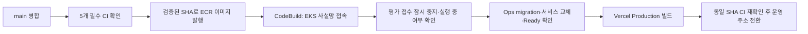

# main 병합 후 EKS·Vercel 자동 배포

대상은 **개인 저장소 `ilil1/SKN34-4th-1Team`의 `main`**이다. 개인 포크의
기존 GHCR 발행·로컬 Argo 경로는 변경하지 않는다. 아래 구성은 코드로 준비한 것이며,
AWS 스택·GitHub environment·Vercel 프로젝트 설정과 최초 EKS 데이터 복원은 별도로 완료해야 한다.
활성화 전에는 repository variable `EKS_RELEASE_ENABLED`를 비우거나 `false`로 둔다.
학교 저장소의 변경은 개인 저장소 main으로 동기화한 뒤, 그 커밋의 개인 저장소 CI가 통과해야 배포된다.
학교 저장소에 병합하는 것만으로 개인 main을 갱신하지 않으며, 저장소 간 자동 동기화는 추가하지 않는다.

운영 웹은 **[govbiz.vercel.app](https://govbiz.vercel.app)**이며,
[Vercel 프로젝트](https://vercel.com/geonwoo4/govbiz)는 `govbiz`다.
2026-10-12 개인 main `6bfe7a31963aa9f8cf8b2d541a6b14565dff7536`의 필수 CI 5개를 확인하고
웹을 **수동 배포**했다. `--skip-domain`으로 빌드한 뒤 Ready와 동일 main CI를 다시 확인해 promote했다.
운영 웹·Core/AI health·Ops session은 HTTP 200, 익명 평가 이력은 401이다.
이 수동 배포 성공은 아래 GitHub Actions 자동 배포의 활성화·성공을 의미하지 않는다.
개인 GitHub의 `eks-production` 환경은 main 브랜치만 허용하도록 만들고,
해당 Vercel 프로젝트의 `VERCEL_ORG_ID`·`VERCEL_PROJECT_ID` 변수를 등록했다.
2026-10-11 `VERCEL_TOKEN` Secret 등록도 확인했다. 값과 실제 배포 권한은 읽지 않았다.
repository variable **`EKS_RELEASE_ENABLED=false`를 유지**한다. AWS의 관리형 조직 정책(SCP)이
GitHub OIDC provider 조회(`ListOpenIDConnectProviders`, `GetOpenIDConnectProvider`)를 거절했다.
사용자는 수동 배포 우선을 선택했으며 유료 플랜 전환·장기 AWS 키 발급은 수행하지 않았다.
자동 배포용 `release-stack.yaml`·CodeBuild는 생성하지 않았다. OIDC 권한 문제 해결과 배포 전용
역할 연결 후 첫 자동 실행을 검증해야 한다. EKS 데이터 복원·수동 운영 상태는
[실배포 기록](sydney-demo.md#2026-10-12-수동-배포-기록)을 참고한다.

## 배포 흐름

[`eks-release.yml`](../../.github/workflows/eks-release.yml)은 기존 CI 5개의 완료 이벤트를 받는다.
한 CI만 성공해도 배포되는 구조가 아니다. 기존 [`ci_blocked_reason`](../release/gate.py)이
동일 SHA의 필수 job·최신 재실행·변경 범위 증거를 모두 확인한다. PR 검사, 다른 브랜치,
학교 저장소나 다른 포크, main의 이전 SHA, 필수 검증 누락·실패·취소는 발행·배포를 허용하지 않는다.
정책이 영향 없음을 별도로 입증한 job의 생략만 기존 CI 정책대로 처리한다.

- GitHub Actions: AWS OIDC 임시 자격 증명으로 5개 ECR 이미지를 발행한다. AWS 장기 키를
  GitHub Secret에 넣지 않는다. Git에 기록된 지정 경로만 빌드하고 로컬 `.env`·데이터는 제외한다.
- ECR: Core·Catalog·AI·Ops·evaluation-runner를 `git-<전체 SHA>`의 immutable 태그로 발행한다.
  같은 태그가 있으면 digest를 재사용하며, Kubernetes에는 태그가 아닌 digest를 전달한다.
- CodeBuild: 기존 EKS의 private subnet에서 실행한다. GitHub runner를 위해 EKS API를
  `0.0.0.0/0`에 열지 않는다. 버전이 고정된 S3 ZIP에는 배포 코드·CI 정책과 이미지 명세만 들어간다.
  CodeBuild도 공개 GitHub API로 해당 SHA의 CI를 다시 검사하며 API 오류·한도 초과 시 중단한다.
- 배포 대상: Core·Catalog·AI·Ops(ops-sync 포함), 평가 실행기, 보고서 서비스다. 보고서 서비스는
  같은 Ops 이미지를 사용한다. DB·큐·검색 엔진·Langfuse·PVC·네트워크 구성은 자동 교체하지 않는다.
- Vercel: 동일 커밋의 웹·shared 소스만 Production 설정으로 빌드하고 `--skip-domain`으로
  운영 주소 전환을 보류한다. 빌드 후 main SHA와 필수 CI를 다시 검사한 뒤 `promote`한다.
  [`vercel.json`](../../frontend/web/vercel.json)의 `git.deploymentEnabled.main=false`는
  CI를 기다리지 않는 기본 Git 자동 배포와 중복 실행을 막는다. 다른 브랜치 Preview 설정은 유지한다.

전체 workflow와 CodeBuild를 각각 직렬화하며 migration 중인 실행을 새 push로 취소하지 않는다.
뒤에 대기 중인 오래된 커밋은 실행 시점의 main 확인에서 거절된다. 같은 SHA의 CI 완료 이벤트가
여러 번 도착해도 ECR 이미지는 재사용하고, 완료 표시와 모든 image digest·Ready가 일치하는
EKS 배포는 다시 중지·migration하지 않는다. Vercel은 후속 workflow에서 같은 소스로 재빌드될 수 있다.

## 최초 연결 순서

1. [시드니 EKS 구성](sydney-demo.md)으로 클러스터를 만들고 최초 데이터 복원·백엔드 기동을
   끝낸다. 웹은 Vercel을 유지한다. 이 CD는 빈 클러스터를 설치하거나 데이터를 이전하는 도구가 아니다.
2. AWS 계정의 GitHub OIDC provider(`https://token.actions.githubusercontent.com`, audience
   `sts.amazonaws.com`)를 확인한다. 이미 있으면 재생성하지 않는다.
3. [`release-stack.yaml`](release-stack.yaml)의 CloudFormation 변경 세트를 검토하고 적용한다.
   입력은 `ClusterName`, `VpcId`, `PrivateSubnetIds`, `ClusterSecurityGroupId`,
   `GitHubOidcProviderArn`이다. **실제 생성은 비용을 포함한 배포 단계에서 수행한다.**
   ECR 5개, S3 입력 버킷, CodeBuild·로그·전용 IAM 역할·SG, EKS access entry가 만들어진다.
   ECR을 최초 이미지 이전보다 먼저 만들거나, 이미 같은 이름의 저장소가 있으면 소유권을 확인해
   CloudFormation에 import한다. 기존 저장소를 삭제해서 맞추지 않는다.
4. 관리자 kubeconfig로 [`release-rbac.yaml`](release-rbac.yaml)을 새 EKS에 적용한다.
   CodeBuild access entry의 `govbiz-eks-release` 그룹을 두 namespace의 배포 권한에 연결한다.
   클러스터 관리자 역할이나 DB/PVC 삭제 권한은 부여하지 않는다. 단, Ops Pod exec와 migration
   Job 생성은 애플리케이션 자격 증명으로 코드를 실행할 수 있으므로 전용 배포 역할로만 사용한다.
5. 개인 GitHub 저장소 `ilil1/SKN34-4th-1Team`의 **Settings → Environments → `eks-production`**을 만들고
   deployment branch를 **`main`만** 허용한다. OIDC trust가 이 저장소·environment에 한정되어 있다.
   승인자 없이 실행하려면 required reviewer를 두지 않되 main 보호 규칙의 필수 CI는 유지한다.
   문서를 수정하는 것만으로 원격 environment·브랜치 보호가 설정되지는 않는다.
6. 아래 변수·Secret을 등록하고 Vercel 프로젝트를 같은 저장소에 연결한다. 처음 만드는 경우
   [Vercel 최초 설정](#vercel-최초-설정)을 먼저 따른다. Root Directory는
   `frontend/web`, 외부 workspace 소스 포함, Node 24.x, pnpm 11.22.x다. Vercel 운영 API 주소,
   Core/Ops 프록시와 OAuth·쿠키 설정은 [웹 연결 절차](sydney-demo.md#웹-배포와-api-연결)를 따른다.
   [외부 API 구성](api-entrypoint.md)을 검증한 뒤 `GOVBIZ_OPS_PROXY_ENABLED=true`로 열어야 한다.
   미연결 Ops의 기본 503 차단은 CD 추가만으로 해제되지 않는다.
7. 클러스터·원본 데이터·Vercel 외부 API 경로를 확인한 뒤 마지막에 repository variable
   `EKS_RELEASE_ENABLED=true`를 설정한다. workflow가 main에 병합되어 있어야 한다.
   첫 실행은 main의 모든 CI가 끝난 뒤 수동 dispatch로 확인할 수 있으며 이후 CI 완료 시 자동 실행된다.
   수동 실행도 같은 SHA·CI·권한 검사를 통과해야 한다.

## Vercel 최초 설정

아직 프로젝트가 없으면 AWS보다 먼저 웹 프로젝트와 운영 주소를 만들 수 있다.
이 단계에서는 웹 빌드와 화면 표시까지만 확인한다. EKS의 외부 API 연결 전에는 로그인·검색·Ops API가
503을 반환하며, 배포 화면의 Ready가 전체 서비스 연동 완료를 뜻하지 않는다.

1. [Vercel 새 프로젝트](https://vercel.com/new)에서 GitHub 계정으로 로그인한다.
   **Import Git Repository**의 계정 선택을 `ilil1`로 바꾸고 `SKN34-4th-1Team`을 선택한다.
   연결 대상은 `ilil1/SKN34-4th-1Team`이며 학교 조직을 선택하지 않는다.
   저장소가 보이지 않으면 **Adjust GitHub App Permissions**에서 개인 계정의 Vercel 앱에
   해당 저장소 접근을 허용한다. 개인 저장소 소유자 계정으로 연결해야 한다.
   [공식 개인 저장소 권한 안내](https://vercel.com/docs/git/vercel-for-github#personal-account-repositories)를 따른다.
2. 프로젝트 생성 화면을 다음과 같이 맞춘다. 이미 저장소의 `vercel.json`에서 읽은 값은 그대로 둔다.

   | 항목 | 값 |
   | --- | --- |
   | Project Name | 원하는 이름, 예: `govbiz-web` — 사용 가능 여부에 따라 실제 주소가 정해짐 |
   | Framework Preset | `Vite` |
   | Root Directory | `frontend/web` |
   | Include source files outside of the Root Directory in the Build Step | 켜기 — shared와 루트 workspace/lockfile 필요 |
   | Node.js Version | `24.x` — 생성 화면에 없으면 생성 후 Settings → Build and Deployment에서 확인 |
   | Install Command | `cd ../.. && pnpm --filter govbiz-web... install --frozen-lockfile` |
   | Build Command | `pnpm build` |
   | Output Directory | `dist` |

   pnpm 버전은 루트 `package.json`의 `packageManager`를 사용한다.
   외부 소스 포함 옵션은 [공식 monorepo 안내](https://vercel.com/docs/monorepos/monorepo-faq#can-i-share-source-files-between-projects-are-shared-packages-supported)를 참고한다.
3. Environment Variables에 `VITE_CORE_API_BASE_URL=/`를 추가하고 최초 **Deploy**를 실행한다.
   AWS 주소·비밀값은 아직 만들지 않았다면 임의 값이나 localhost로 채우지 않는다.
   첫 배포가 끝나면 Settings → Domains에서 실제 고정 `https://….vercel.app` 주소를 확인한다.
   프로젝트 이름과 도메인 이름이 항상 같다고 가정하지 않는다.
4. AWS API 진입점이 준비된 뒤 다음 **서버 전용 환경변수는 Production에만** 등록한다.
   값 변경은 다음 배포에 반영된다.

   | 이름 | 값 |
   | --- | --- |
   | `GOVBIZ_FRONTEND_ORIGIN` | `https://govbiz.vercel.app` — 마지막 `/` 없이 |
   | `GOVBIZ_API_ORIGIN` | 현재 미들웨어가 허용하는 실제 `https://….cloudfront.net` 주소 |
   | `GOVBIZ_PROXY_SECRET` | 백엔드와 동일한 64자리 hex 프록시 비밀값 |
   | `GOVBIZ_OPS_PROXY_ENABLED` | EKS Core/Ops 분기 검증 후에만 `true`, 그 전에는 `false` |

   AWS 자격 증명·OpenAI 키·DB 비밀번호는 웹 빌드 변수에 넣지 않는다.
   Core/Ops 라우팅과 인증 연결은 [EKS API 연결](sydney-demo.md#웹-배포와-api-연결)을 완료해야 한다.
5. GitHub Actions 연결에 사용할 값을 확인한다.
   프로젝트 Settings → General의 **Project ID**를 `VERCEL_PROJECT_ID`,
   소유 팀 Settings → General의 **Team ID**를 `VERCEL_ORG_ID`에 넣는다.
   [Vercel Account Tokens](https://vercel.com/account/settings/tokens)에서 해당 팀의 `govbiz` 프로젝트 범위 토큰을 만들고
   GitHub `eks-production` environment의 `VERCEL_TOKEN` **Secret**에 직접 저장한다.
   토큰을 채팅이나 Git에 붙여 넣지 않는다. 이 세 값은 Vercel 빌드 환경변수가 아니다.
6. Settings의 Production Branch가 `main`인지 확인한다. 이번 `vercel.json` 변경이 main에 반영되면
   기본 Git push의 main 자동 배포는 비활성화된다. **GitHub Actions가 CI 통과 후 배포를 담당**하며,
   `EKS_RELEASE_ENABLED=false` 상태에서는 운영 자동 배포도 시작하지 않는다.
   프로젝트 최초 생성·AWS 연결·환경변수 확인 후 위의 최초 연결 순서 마지막 단계에서 켠다.

Vercel 프로젝트 생성·요금제 선택은 개인 계정에서 진행한다. 요금제별 사용량과 협업 조건은
[Vercel Git 안내](https://vercel.com/docs/git)의 현재 정책을 확인한다.

### GitHub 변수와 Secret

| 위치 | 이름 | 값 |
| --- | --- | --- |
| Repository variable | `EKS_RELEASE_ENABLED` | 최초 연결 완료 전 `false`, 완료 후 `true` |
| `eks-production` variable | `AWS_ACCOUNT_ID` | 실제 AWS 계정 ID |
| 같은 위치 | `EKS_CLUSTER_NAME` | 생성한 EKS 이름 |
| 같은 위치 | `EKS_RELEASE_ROLE_ARN` | 스택 출력 `ReleaseRoleArn` |
| 같은 위치 | `EKS_RELEASE_BUCKET` | 스택 출력 `ReleaseBucketName` |
| 같은 위치 | `EKS_DEPLOY_PROJECT` | 스택 출력 `DeployProjectName` |
| 같은 위치 | `VERCEL_ORG_ID` | Vercel 소유 팀·계정 ID |
| 같은 위치 | `VERCEL_PROJECT_ID` | 위에서 만든 웹 프로젝트 ID |
| 같은 environment의 Secret | `VERCEL_TOKEN` | 해당 프로젝트 배포 권한의 토큰. Git·채팅에 기록하지 않음 |

리전은 이 시연의 `ap-southeast-2`로 고정한다. CodeBuild·ECR·S3·로그와 Vercel 이용량은
기존 EKS 노드 비용 외에 발생할 수 있으므로 시연 예산에 추가한다.

## 배포 실패와 데이터 보호

- 시작 전에 6개 Deployment가 실행 중인지 확인한다. 운영자가 정지시킨 서비스를 자동으로 켜지 않는다.
- 기존 Ops 접수 제어로 새 접수를 잠시 닫고 감사 이력을 남긴다. 접수·대기·실행·취소 중인 평가가
  있으면 새로 닫은 접수를 복구하고 실패로 끝낸다. 실행을 취소하거나 예산을 환급하지 않는다.
  평가 종료 후 workflow를 다시 실행한다. 별도 재시도 스케줄은 만들지 않는다.
- 평가가 없으면 실행기와 Ops(동일 Pod의 sync 포함)를 멈춘다. 새 Ops 이미지의
  `migrate_deployment`를 별도 Job에서 실행한 뒤 서비스별 이미지를 바꾸고 rollout을 기다린다.
  Core·Catalog의 Flyway는 기존 기동 경로를 따른다. **일시적인 Ops 중단이 있는 단일 replica 시연 구성**이다.
- 모든 rollout이 완료되면 이번 배포가 닫았던 접수만 같은 버전 조건으로 복구한다.
  사람이 먼저 닫아 둔 접수는 열지 않는다. 중간에 사람이 변경한 접수 버전도 덮어쓰지 않는다.
- migration·rollout이 실패하면 후속 이미지 교체와 Vercel 전환을 중단한다. 이미 적용된 DB migration을
  되돌리거나 전체 서비스를 자동 rollback하지 않는다. 일부 서비스가 새 버전일 수 있다.
  스키마·API 변경은 앞뒤 버전이 함께 동작할 수 있도록 설계해야 하며 파괴적 변경은 별도 승인 대상이다.
- `ops-service` metadata의 `govbiz.io/release-in-progress`가 남으면 다음 자동 배포도 중단한다.
  CodeBuild 로그의 접수 버전, migration Job 상태, 각 서비스 이미지와 Ready, 평가 실행 여부를 확인하고
  필요한 서비스를 검토한 버전으로 복구한 뒤 접수 상태를 복구한다. 그 다음 관리자가 이 표시를 지우고 재실행한다.
  표시만 지워서 실패 원인을 숨기지 않는다. 성공 시 `govbiz.io/release-complete`에 SHA를 남긴다.
- GitHub/CodeBuild 시간 초과나 취소는 성공이 아니다. CodeBuild가 아직 동작 중일 수 있으므로
  출력된 build ID의 실제 종료 상태를 확인한다. Vercel 빌드 실패 시 기존 운영 도메인은 유지된다.

## 검증 범위

`test_eks_release.py`는 허용 저장소·브랜치·CI, 변경 도중 main 이동, ECR 명세, migration·배포 실패,
기존 접수 중단 보존, 중복 이벤트, 이전 배포 실패 표시, 소스 archive, workflow와 IAM 연결을 무료로 검사한다.
기존 Infra CI의 `test_*.py` 탐색에 포함되며, 공통 CI gate의 회귀 테스트는 기존 GovBiz CI에서도 수행한다.
Infra CI는 `cfn-lint==1.46.0`으로 CloudFormation 타입·참조·IAM 구문도 오프라인 검사한다.
CloudFormation 구문 검사·단위 테스트는 실제 AWS 역할 인수, ECR push, 사설망 접속, MySQL migration,
Vercel 프로젝트 배포를 대신하지 않는다. 최초 실배포 후 정확한 SHA의 배포 이력을 별도로 확인해야 한다.

참고: [AWS OIDC](https://docs.github.com/en/actions/how-tos/secure-your-work/security-harden-deployments/oidc-in-aws),
[CodeBuild VPC 연결](https://docs.aws.amazon.com/codebuild/latest/userguide/vpc-support.html),
[Vercel staged production](https://vercel.com/docs/cli/deploy#skip-domain),
[Vercel Git trigger 설정](https://vercel.com/docs/project-configuration/git-configuration).
