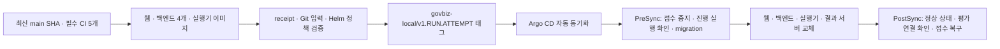

# 로컬 Argo CD 자동 배포

개인 포크 main의 **같은 최신 SHA에 대한 필수 CI 검증 → GHCR 이미지 → 불변 배포 태그 → Argo 자동 동기화**로 연결합니다.
별도 배포 브랜치·PR은 만들지 않으며 `MSA_PROMOTION_ENABLED=false`를 유지합니다.
구현 파일과 오프라인 검증을 실제 클러스터 활성화·배포 성공 기록과 구분합니다. 이 문서 추가 시점에는 원격 변수와 기존 Application을 변경하지 않았습니다.

## 실행 경로



| 항목 | 계약 |
|---|---|
| 이미지 발행 | [Local Argo release](../../../.github/workflows/local-release.yml)가 기존 발행기를 사용합니다. 6개 이미지 모두 같은 SHA·실행 attempt의 receipt가 있어야 합니다. 이미 검증한 입력의 이미지는 재사용합니다. |
| 발행 직전 확인 | 개인 포크의 최신 main, 원본 병합, 필수 CI 및 receipt를 다시 확인합니다. 바뀌거나 일부 발행이 실패하면 태그를 만들지 않습니다. |
| Git 배포 입력 | [local_release.py](../scripts/local_release.py)가 테스트된 소스의 Chart를 렌더링합니다. snapshot에는 이미지 digest·원본 SHA·receipt·CI 근거를 보관하며 기존 태그를 덮어쓰지 않습니다. |
| Argo 추적 | Argo CD **3.5.3**의 `tagPrefix: govbiz-local/`와 `targetRevision: '>=1.0.0 <2.0.0'`으로 최신 배포 태그를 추적합니다. [공식 태그 추적 설명](https://argo-cd.readthedocs.io/en/stable/user-guide/tracking_strategies/) |
| 자동 적용 범위 | 하나의 `govbiz-local` Application이 웹·Core·Catalog·AI·Ops(`ops-sync` 포함)·평가 실행기·결과 서버의 Deployment 7개와 관련 Service·NetworkPolicy·Job을 관리합니다. |
| 데이터·기반 도구 | DB·PVC·Secret·namespace와 Prefect 서버·Langfuse는 기존 설치를 유지합니다. 자동 앱 배포에 저장소 이전이나 기반 도구 업그레이드를 섞지 않습니다. |
| 동기화 설정 | `automated.enabled=true`, `prune=false`, `selfHeal=false`. 새 Git 배포 입력은 자동 적용하며 리소스 자동 삭제와 같은 revision의 무한 복구는 끕니다. 실패한 sync는 30초부터 최대 5분 간격으로 5회 재시도합니다. |
| 개발 반영 | Vite HMR·Expo Fast Refresh는 그대로 사용할 수 있습니다. 클러스터의 같은 Deployment에 `dev.py`와 Argo를 동시에 연결하지 않습니다. |

AWS EKS·Vercel의 CodeBuild 배포는 [별도 운영 경로](../../eks/continuous-deployment.md)이며 이 workflow가 AWS를 변경하지 않습니다.

## 평가·migration 보호

PreSync Job의 `manage.py local_release prepare --release <태그>`는 기존 접수 잠금과 감사 이력을 사용합니다.
접수 중지를 먼저 커밋한 뒤 `REQUESTED·QUEUED·RUNNING·CANCELLING` 실행이 하나라도 남으면 migration과 교체를 막습니다.
기존 평가는 계속 종료·정산할 수 있습니다. 다음 재시도에서 실행이 모두 끝났으면 기존 MySQL 잠금이 있는 `migrate_deployment`를 실행합니다.
빈 DB 최초 설치는 이 경로의 대상이 아닙니다.

모든 배포 리소스가 Healthy가 된 뒤 PostSync Job이 `check_evaluation_runtime`으로 새 자료·결과 서버·Prefect 등록을 확인합니다.
그다음 해당 태그가 만든 접수 중지 버전이 그대로인 경우에만 이전 접수 상태를 복구합니다.
원래 관리자가 접수를 중지했다면 계속 중지합니다. 예전 PostSync 재전송으로 나중의 관리 중지를 해제하지 않습니다.
Job에는 Kubernetes API 토큰·클러스터 수정 권한을 주지 않으며 모델을 호출하지 않습니다.

실패하면 접수 중지를 유지합니다. 다른 태그가 실패한 태그의 접수 중지를 인수하지 않습니다.
원인·migration 상태·실행 종료를 확인한 뒤 같은 태그를 재시도하거나 기존 `evaluation_admission` 명령으로 운영자가 복구합니다.
이미 접수 복구를 끝낸 태그를 다시 동기화하는 경우에는 새 workflow 실행으로 새 태그를 발행합니다.
DB를 과거 버전으로 되돌리는 자동 rollback은 하지 않습니다.

## 기존 로컬 환경의 최초 전환

현재 도구는 **Kubernetes 이전을 끝낸 무료 평가 환경**을 대상으로 합니다.
활성 유료 평가·정기 실행 설정은 자동으로 바꾸지 않고 입력 검증에서 차단합니다.
이전의 서비스별 수동 Application을 새 Application과 동시에 같은 리소스에 연결하지 않습니다.

1. 로컬 kind의 전용 kubeconfig·context와 대상 namespace를 확인합니다. DB·평가 결과 백업 및 복구 경로를 확보하고 기존 Application YAML도 비공개 경로에 보관합니다.
2. 개인 포크의 6개 GHCR 패키지가 본인 소유·포크 연결·공개 상태인지 확인합니다. workflow는 패키지를 새로 만들거나 공개 범위를 바꾸지 않습니다. `MSA_RELEASE_ENABLED=true`, `LOCAL_ARGO_RELEASE_ENABLED=true`로 발행을 허용합니다. `msa-release` environment에 승인 대기가 설정되어 있다면 해당 보호 정책을 따릅니다.
3. 코드가 기본 브랜치에 반영되고 필수 CI가 통과한 뒤 `Local Argo release`의 성공 및 `govbiz-local/*` 태그를 확인합니다. 최초 배포 태그가 없으면 Application을 적용하지 않습니다. Git 태그의 수정·삭제 제한은 GitHub 저장소 설정에서 별도로 관리하며 이 코드는 원격 보호 규칙을 변경하지 않습니다.
4. 기존 실행 중인 Deployment를 아래처럼 내보내고 자동 Application 파일을 만듭니다. 출력은 mode `0600`이며 설정값이 들어 있으므로 Git에 넣지 않습니다.

```bash
umask 077
mkdir -p infrastructure/gitops/.local/auto-sync
# 대상 로컬 context를 확인한 셸에서 실행합니다.
kubectl get deployments -A -o json > infrastructure/gitops/.local/auto-sync/runtime.json
python -B infrastructure/gitops/scripts/local_release.py application \
  --runtime infrastructure/gitops/.local/auto-sync/runtime.json \
  --output infrastructure/gitops/.local/auto-sync/application.yaml
```

출력은 서비스 환경변수·Secret **참조**, 실행기·결과 서버의 기존 결과 PVC와 노드를 Kustomize patch로 보존합니다.
이미지·실행 명령을 patch하지 않으므로 다음 태그의 이미지 갱신을 막지 않습니다. Secret 값 자체를 조회하지 않습니다.
자원 한도·probe 등 나머지 항목은 테스트된 Chart를 따릅니다. 적용 전에 새 렌더링과 현재 리소스의 차이를 검토해야 합니다.

5. 로컬 watcher를 종료하고 기존 웹·업무 4개·실행기·결과 서버 Application의 자동 sync를 끈 뒤 진행 중인 operation이 없는지 확인합니다. 해당 Application만 **리소스를 남기는 orphan 방식**으로 해제하고 기존 Argo tracking annotation/label도 해당 업무 리소스에서만 정리합니다. Prefect·관측·데이터 Application은 유지합니다. `FailOnSharedResource=true`를 끄거나 강제 동기화로 충돌을 무시하지 않습니다.
6. 확인한 자동 Application YAML을 Argo에 적용합니다. 이 최초 관리권 이전은 별도 작업이며 생성 명령은 클러스터를 변경하지 않습니다. 이후 새로운 검증 태그는 자동 동기화됩니다.
7. `govbiz-local`의 Synced/Healthy, 두 hook 성공, 실제 digest, Ops 접수 상태, 기존 관리자 로그인·보고서·평가 이력 보존을 확인합니다. 이미지 발행이나 오프라인 렌더링 성공만으로 이 검증을 완료했다고 보고하지 않습니다.

workflow의 실패한 job만 재실행하면 이전 attempt receipt를 사용하지 않으므로 태그 발행이 차단됩니다. **전체 job 재실행** 또는 새 workflow 실행을 사용합니다.
기존 `fork_cluster.py`의 서비스별 Argo 진단·`dev` 전환 도구는 새 단일 Application을 관리하지 않습니다. 자동 환경에서는 `argocd app get govbiz-local`과 Kubernetes 상태를 확인하고, 개발 모드 복귀 전에 같은 orphan 인계 절차를 거칩니다.

## 검증

- Infra CI: 모든 receipt의 소스·정책·플랫폼·digest·attempt·archive checksum 검증, 불완전 발행 차단, 태그 덮어쓰기 금지, 실제 Helm·Kustomize 렌더링, env/PVC patch가 이미지 갱신을 가리지 않는지 검사합니다.
- Ops CI: 실제 MySQL 8.4에서 접수 감사 이력·진행 실행 차단·동일 태그 재시도·관리자 중지 보존·다른 태그의 인수 금지를 검증합니다.
- 로컬 단위·오프라인 검사와 원격 CI·실제 Argo 배포 성공은 각각 구분해 기록합니다.
